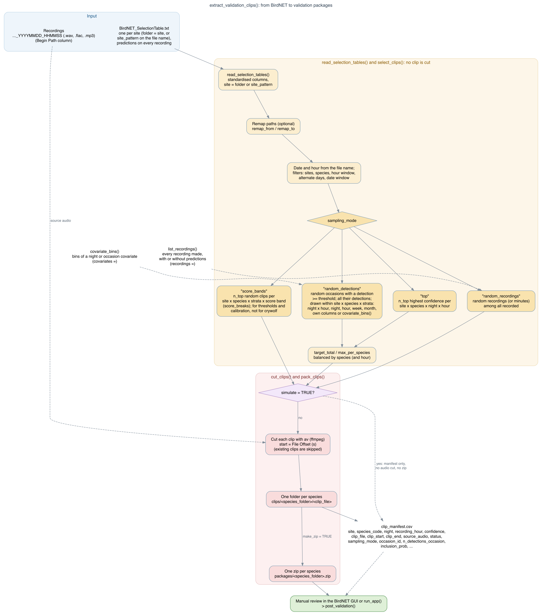

# sheepdog 

[](https://doi.org/10.5281/zenodo.22696210)
[](LICENSE.md)
[](https://diogoprov.r-universe.dev/sheepdog)
[](https://app.codecov.io/gh/diogoprov/sheepdog)

In the fable, the boy cries "wolf!" and the villagers have to decide whether
the wolf is real. **sheepdog** does that check for automated predictions from
[BirdNET](https://github.com/birdnet-team/BirdNET-Analyzer) pretrained and custom classifiers
in passive acoustic monitoring (PAM). It runs three stages:

1. **Validation data.** Build clip sets for manual review from the BirdNET
   selection tables: top-score, random-occasion or random-recording designs,
   one folder per species, ready for the review tab of the BirdNET GUI or for
   the review app of the package (`run_app()`). The random draws can be
   stratified along an environmental gradient. Then
   summarise the reviewed clips: precision by confidence bin, suggested
   thresholds, confirmed presence by night, clips for retraining and the
   cells that still need review.
2. **Calibration.** Turn confidence scores into probabilities of true
   detection with hierarchical logistic models (species and site x species
   effects, compared by cross-validation), fitted with 'lme4' or, in a
   Bayesian framework, with 'brms'. Score every detection and build nightly
   detection histories.
3. **Community matrices.** Turn the calibrated histories into
   effort-standardised site x month matrices for multivariate ordinations.

sheepdog was developed for the FrogNet project (anurans of the Pantanal and
Cerrado, Mato Grosso do Sul, Brazil), but it works with the output of any
BirdNET pretrained and custom classifier. `export_occupancy_data()` writes its
validation and calibration outputs in a documented format for occupancy models
with false positives, such as those fitted with
[crywolf](https://github.com/diogoprov/crywolf).
The two packages are independent: sheepdog does not depend on crywolf.


## Installation

Install the package from [r-universe](https://diogoprov.r-universe.dev/sheepdog),
which provides binaries for Windows, macOS and Linux:

```r
install.packages("sheepdog",
                 repos = c("https://diogoprov.r-universe.dev",
                           "https://cloud.r-project.org"))
```

The development version can be installed from GitHub:

```r
# install.packages("remotes")
remotes::install_github("diogoprov/sheepdog")
```

Cutting the clips for review (the 3-s windows that BirdNET analyses, or whole
recordings in the random-recording design) needs
[av](https://cran.r-project.org/package=av) (it bundles ffmpeg), the
hierarchical calibration needs
[lme4](https://cran.r-project.org/package=lme4), and the figures need
[ggplot2](https://cran.r-project.org/package=ggplot2):

```r
install.packages(c("av", "lme4", "ggplot2"))
```

## Calibration performance

In threshold-based approaches, calibration automatically compares global and site-effect
models per species; with one site, it keeps only estimable candidates. Explicit model
lists remain available in `compare_calibration_models()`.

The [performance article](https://provetelab.org/sheepdog/articles/performance.html)
summarises the Curiango benchmark, regression checks, computing times and
an explicitly simulated multispecies benchmark. The results do not show a
consistent advantage of one selection rule across datasets.

## Grouped calibration folds

Use `calibrate(..., fold_group = "source_audio")` to keep recordings
intact, or `fold_group = "night"` to keep nights intact across species at
each site. The input validation tables must contain those metadata;
each site needs at least `k_folds` groups. The default remains clip folds.
For a manual workflow, retain the metadata with
`read_validations(..., keep = c("source_audio", "night"))` and inspect the
assignment with `calibration_folds()`. See the calibration article for
examples and limitations.

## Migrating from 2.x

In 3.0.0, calibration defaults to `select = "one_se_logloss"`.
Use `select = "best_auc"` to preserve the 2.x model selection. See the
[migration guide](https://provetelab.org/sheepdog/articles/migration-3.0.0.html)
for details and comparison of downstream results.

## Usage

```r
library(sheepdog)

# 1a. Clips to review: check the selection first, then cut
extract_validation_clips("N:/Arara", "N:/Arara/validation",
                         remap_from = "N:/", remap_to = "/Volumes/Arara/",
                         simulate = TRUE)
extract_validation_clips("N:/Arara", "N:/Arara/validation",
                         remap_from = "N:/", remap_to = "/Volumes/Arara/")

# 1b. After the review in the BirdNET GUI
post_validation(review_dir    = "N:/Arara/validation/clips",
                manifest_path = "N:/Arara/validation/clip_manifest.csv",
                output_dir    = "N:/Arara/validation/results")

# or after the review in the app, run_app()
post_validation(manifest_path = "N:/Arara/validation/clip_manifest.csv",
                output_dir    = "N:/Arara/validation/results",
                verdicts_file = "N:/Arara/validation/verdicts.csv")

# 2. Calibration and nightly detection histories
calibrate(validation_files  = c("UEM/validation_by_clip.csv",
                                "ARA/validation_by_clip.csv"),
          prediction_tables = c(UEM = "UEM/BirdNET_SelectionTable.txt",
                                ARA = "ARA/BirdNET_SelectionTable.txt"),
          output_dir        = "calibration")

# 3. Community matrices
build_community_matrices("calibration/nightly_detection_history.csv",
                         "community_matrices",
                         core_species = c("boa_ran", "den_nan", "phy_alb"))
```

Each stage is also available as separate functions:

| Stage | Functions |
|---|---|
| 1. Selecting and cutting clips | `read_selection_tables()`, `list_recordings()` (every recording made, with or without predictions), `select_clips()` (a pure function that returns the clip manifest without touching audio), `covariate_bins()` (strata along a gradient), `cut_clips()`, `pack_clips()` |
| 1. Review app | `run_app()` (local 'shiny' app: choose the folders and see the recordings per site and night, draw and cut the clips, review them with spectrogram, player and keyboard verdicts written to a CSV, and export the occupancy tables), `app_verdicts()` |
| 1. Several reviewers | `assign_reviewers()`, `split_by_reviewer()`, `reviewer_agreement()` (Cohen's or Fleiss' kappa), `consensus_verdicts()` |
| 1. After the review | `classify_review()`, `precision_by_bin()`, `suggest_thresholds()`, `plot_precision()`, `nightly_presence()`, `retraining_clips()`, `read_validation_tables()`, `review_support()` (cells, or bins, that still need review) |
| 1. Retraining | `build_training_set()` (training folders for BirdNET-Analyzer), `exclude_training_clips()`, `training_nights()` |
| 2. Calibration | `read_validations()`, `calibration_models()`, `calibration_folds()`, `compare_calibration_models()`, `select_calibration_model()`, `fit_calibration()`, `calibration_quality()` (held-out quality of P(TP) by species), `calibrated_thresholds()` (a threshold per site x species from the model), `calibration_effort()`, `score_detections()`, `detection_history()`, `summarise_history()` |
| 2. Bayesian calibration | `calibration_prior()`, `prior_predictive_calibration()`, `calibration_diagnostics()`, `calibration_ppc()`, `plot_calibration_ppc()`, `calibration_sensitivity()`, `plot_calibration_draws()`, `history_draws()` |
| Occupancy data | `export_occupancy_data()` (schema `sheepdog-occupancy`), `occasion_draws()` (one detection data set per posterior draw) |
| 3. Community matrices | `cell_status()`, `suggest_core_species()`, `community_matrices()`, `community_matrices_draws()` |

The [articles](https://provetelab.org/sheepdog/articles/) cover each stage
with runnable examples; `vignette("frognet-workflow")` shows the complete
workflow.

The selection tables must have the standard BirdNET/Raven columns
`Begin Time (s)`, `End Time (s)`, `Species Code`, `Confidence`, `Begin Path`
and `File Offset (s)`, and the recordings must be named
`..._YYYYMMDD_HHMMSS`. The site is the name of the folder; when the files of
several sites share a folder, `site_pattern` reads it from the file name.

## Sampling designs

`select_clips()` and `extract_validation_clips()` take `sampling_mode`:

- `"top"` (default) keeps the *N* predictions with the highest confidence per
  site x species x night x hour. It serves retraining and the
  score-to-probability calibration (the model is conditional on the score).
  It does **not** serve to estimate false-positive rates: top-score clips hold
  fewer false positives than a random sample.
- `"random_detections"` follows the observation-confirmation design of
  [Chambert et al. (2015)](https://doi.org/10.1890/14-1507.1): occasions with
  at least one prediction >= `threshold` are drawn at random within strata
  that do not depend on the score, and every prediction >= `threshold` of a
  drawn occasion is cut.
- `"random_recordings"` follows the multiple-method design of
  [Miller et al. (2011)](https://doi.org/10.1890/10-1396.1): recordings (or
  minutes) are drawn among all those recorded, with or without predictions,
  for annotation by ear. The clip is the whole recording and `confidence` is
  `NA`.



The manifest records `occasion_id`, `n_detections_occasion` and
`inclusion_prob` (the probability that the occasion was drawn), with which
`post_validation()` also reports the precision weighted by
`1 / inclusion_prob` and uses it to suggest the thresholds. Every draw
uses a fixed seed, so a rerun selects the same clips, and the cut is
idempotent: an interrupted run resumes where it stopped.

## Calibration

[Wood & Kahl (2024)](https://doi.org/10.1007/s10336-024-02144-5) describe the
conversion of BirdNET confidence scores into probabilities for studies in which
the predictions cannot all be reviewed;
calibration by logistic regression on logit(score) is applied, for instance,
by [Owens et al. (2026)](https://doi.org/10.64898/2026.06.01.729442).
`calibrate()` extends that approach with a hierarchical multi-species
structure,

```
tp ~ logit(conf) + (logit(conf) | species) + (1 | site:species)
```

because the same score corresponds to very different probabilities of a true
detection across species and sites. The candidate models are compared by
stratified k-fold cross-validation, which scores both discrimination (AUC)
and the predicted probabilities (log-loss, Brier score, calibration
intercept and slope); `select_calibration_model()` picks a model by the
highest AUC or by the simplest model within one standard error of the lowest
log-loss, leaving out singular fits. `calibration_quality()` then
scores the held-out predictions of that model species by species, against a
null model, because measures over all the clips can hide a species whose
score says little.

The selected model can also be fitted in a Bayesian framework with 'brms'
(`engine = "brms"`), with an explicit prior, convergence diagnostics,
posterior predictive and prior sensitivity checks. Each detection then gets
the posterior probability that it is reliable, and the uncertainty of the
calibration can be propagated to the detection histories and the community
matrices (`vignette("bayesian-calibration")`).

## Integration with crywolf

`clip_manifest.csv` and `validation_by_clip.csv` are the hand-off to
occupancy models with false positives. `vignette("crywolf-integration")`
specifies their columns, types and the definition of an occasion; example
files are in `system.file("extdata", package = "sheepdog")`. Do not pass the
whole-recording clips of `"random_recordings"` (`confidence = NA`) to the
`validation` argument of `crywolf::fp_aggregate()`: they are the second method
(manual annotation), not confirmations of detections.

`export_occupancy_data()` writes occasions, detections, verdicts and, with a
Bayesian calibration, its posterior draws to one folder, described by
`schema.json` (schema `sheepdog-occupancy`). `occasion_draws()` turns that
folder into one detection data set per posterior draw, so that any occupancy
software can propagate the uncertainty of the calibration; crywolf reads the
folder directly.

## From the scripts (v1.2.0) to the package (v2.0.0)

Up to v1.2.0 this repository held four R scripts. Version 2.0.0 turns them
into the sheepdog package, with English function names, arguments, output
columns and values. `NEWS.md` maps every script setting to its argument and
every old column to its new name. The package reads manifests, validation
tables and histories written by v1.2.0, so validated data stay usable. The
scripts are preserved in the
[v1.2.0 tag](https://github.com/diogoprov/sheepdog/tree/v1.2.0).

## Authorship and citation

Developed by **Diogo B. Provete** (Universidade Federal de Mato Grosso do Sul),
from the protocol design of **Larissa S. M. Sugai** (Cornell Lab of
Ornithology) and **Liliana Piatti** (UFMS), within the FrogNet project. Code
written with AI assistance (Claude, Anthropic), with human review and tests.

If sheepdog is useful in your work, please cite it (GitHub's "Cite this
repository" button uses `CITATION.cff`):

> Provete, D. B., Sugai, L. S. M., & Piatti, L. (2026). *sheepdog: sample,
> validate and calibrate BirdNET detections for passive acoustic monitoring*.
> Zenodo. https://doi.org/10.5281/zenodo.22696209

The hex sticker uses a dog silhouette by Mozillian from
[PhyloPic](https://www.phylopic.org/images/d3e8133c-e669-4881-9111-b44145f94212)
(CC0 1.0).

## License

[MIT](LICENSE.md)
