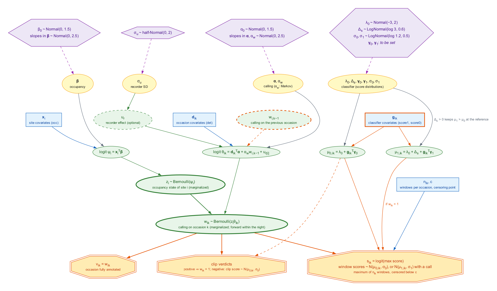

# Roadmap: integração sheepdog + crywolf

Escrito em 24/10/2026, com a `main` do sheepdog em `7e9c785` (3.2.1,
candidata ao CRAN) e o crywolf em `c9e2287` (1.7.0.9000, a caminho do 2.0.0).
É um plano, não uma decisão: os itens **[decidir]** dependem do Diogo. Vale
para os dois repositórios; uma cópia (ou um link) deve ir para
`crywolf/dev/`.

## Objetivo

Hoje o fluxo tem três etapas em sequência: score do BirdNET → limiar ou
calibração (sheepdog) → histórico binário → modelo de ocupação (crywolf ou
spOccupancy). A incerteza se perde em cada etapa, e o resultado depende de
escolhas que o modelo não enxerga. O objetivo é **um caminho único, do
score à ocupação, com a incerteza propagada**, em que:

- o sheepdog é a camada de **medição**: desenho da validação com
  probabilidades de inclusão conhecidas, revisão, calibração e proveniência;
- o crywolf é a camada de **processo**: ocupação (depois dinâmica e
  multiespécies) com um modelo de observação que usa os scores e as
  verificações;
- os dois continuam independentes (nenhum importa o outro); a ligação é um
  **contrato de dados** documentado nos dois pacotes.

## Por que agora: o que o artigo do Curiango mostrou

O artigo do Curiango, aceito no JAV (ms JAV-03737) [CITAR: referência
completa quando sair; dados em https://doi.org/10.5281/zenodo.21795898],
analisou os mesmos 97.906 minutos de áudio por quatro caminhos (dois
classificadores × dois limiares) e três estruturas de modelo. Cinco
resultados dele motivam este roadmap diretamente:

1. **O limiar e o classificador pesaram mais que o modelo.** A ocupação
   predita em temperaturas baixas diferiu em mais de 65 pontos percentuais
   entre os caminhos PreBuilt–MaxF1 e Custom–MaxPrecision. É o argumento
   mais forte para tirar o limiar do caminho (fases 1 e 2).
2. **O trade-off precisão × recall não tem solução dentro do paradigma do
   limiar.** MaxPrecision quase zera o p10 mas descarta dados e alarga os
   intervalos; MaxF1 retém dados mas exige o modelo com falsos positivos. A
   recomendação do artigo ("priorizar a precisão em modelos hierárquicos")
   é a melhor possível com limiar; um modelo que usa todos os scores pode
   torná-la desnecessária. Esta é a hipótese central a testar (fase 2).
3. **Detecções de score alto podem ser um subconjunto não aleatório**, cuja
   detectabilidade varia com o ambiente (seção de resultados do artigo). No
   modelo conjunto, isso vira um parâmetro: a distribuição dos scores
   condicionada às covariáveis.
4. **As janelas de uma noite não são independentes**, e todos os PPC de
   sítio falharam por isso; o modelo dinâmico foi descartado como
   "computacionalmente proibitivo" para mais de 1.700 noites. O termo de
   Markov do crywolf já trata a dependência dentro da noite, e o forward de
   dois estados planejado para o `fp_occu_dyn()` custa linear no número de
   noites; o Curiango é o caso de teste natural dos dois.
5. **O efeito da lua deve agir na intensidade do canto, não no "cantou ou
   não"** (discussão do artigo). Pede uma resposta de atividade vocal
   (densidade de chamadas), não binária (fase 4).

Além disso, o Curiango tem o conjunto de validação ideal para a fase 2: 1.199
arquivos (~1 % do total) anotados por completo, sorteados com estratificação
proporcional por sítio. É o equivalente ao `sampling_mode =
"random_recordings"` do sheepdog e identifica as distribuições de scores dos
verdadeiros e dos falsos positivos sem depender do classificador.

## Estado (11/11/2026)

- 11/11/2026: **o que entrou na `main` desde 07/11** (todos para a 3.4.0,
  lista completa no `NEWS.md`):
  - o `run_app()` dá um erro claro quando o manifesto está vazio ou falta
    (sheepdog#122);
  - identidade dos falsos positivos: campo no app com a certeza *sure* ou
    *probable*, `identity_categories()`, `join_identities()` e
    `confuser_summary()` (sheepdog#123). Serve à descrição dos confusores;
    a confusão entre espécies continua fora do modelo (ver "Fora do plano"
    no roadmap do crywolf);
  - rodada dirigida com probabilidade de inclusão conhecida:
    `select_directed()`, `sampling_mode = "directed_pps"` (sheepdog#124).
    Sorteia unidades (por exemplo sítio × espécie × mês) por PPS sistemático,
    proporcional a um tamanho dado pelo usuário (o ganho esperado) mais um
    piso, e uma ocasião candidata por unidade, ao acaso;
    `inclusion_prob = π_unidade / N_ocasiões`. O esquema continua 1.4. O
    pedido veio da lição do Curiango: o modelo de score precisa saber como
    cada clipe revisado foi escolhido, em todas as rodadas;
  - DAG da fase 2 com o prior C nas distribuições do score (sheepdog#125).
- 11/11/2026: **o crywolf e o `directed_pps`.** O `fp_read_sheepdog()` só
  descarta `"top"`, então os clipes `directed_pps` passam sem aviso, embora
  os π variem entre unidades e o crywolf ainda não use `inclusion_prob`. A
  sessão do crywolf foi avisada; aceitar, avisar ou ponderar é decisão do
  crywolf.
- 11/11/2026: **crywolf.** O `fp_occu_ms()` ganhou inclinações por espécie em
  det e fp e verificação por espécie (crywolf#30), e saídas por espécie,
  riqueza (`fp_richness()`) e simulador (crywolf#31). Falta o PR 5 (espécie
  rara e custo); depois vem o `fp_occu_score()`.
- 11/11/2026: **resumo da fase 2** preparado para uma reunião em 13/11 com outro
  laboratório, em revealjs, fora do repositório. Usa só os
  resultados públicos de `dev/fase2/README.md` (simulação e Curiango).
- Esperando resposta: a Liliana, sobre como o conjunto de teste do Curiango
  foi sorteado (perguntado em 07/11; a simulação da mistura segue suspensa),
  e o CRAN, sobre a 3.3.3 (fila `newbies` desde 02/11).
- 07/11/2026: **esquema 1.4 do export**, só com acréscimos, para o modelo de
  score: `n_windows` em `occasions.csv` (e não em `scores.csv`, como previa a
  fase 0, porque é propriedade da ocasião), `round`, `stratum`, `n_candidates`,
  `n_drawn` e `review_scope` em `validation.csv`, e `window_step` e
  `validation_design` no `schema.json`. O `export_occupancy_data()` passa a
  escrever sempre 1.4, em vez de a versão depender das tabelas. Os scores já
  saíam no export e o `fp_read_sheepdog()` já os lê: o que falta é o crywolf
  usá-los, sem agregar para (y, n). A calibração fica fora do contrato do
  modelo de score. Sobre pesos: não entram na verossimilhança conjunta, porque
  a seleção depende de dados observados (inferência, falta simular), mas são
  necessários na precisão, no PPC do critério 6 e em calibração avulsa.
- 06/11/2026: **onde estamos.** A `main` do sheepdog está em 3.3.3.9000
  (`f4a200e`). A 3.3.3 espera a revisão manual
  do CRAN (fila desde 02/11, prazo de cerca de 16/11), e a 3.4.0 espera
  essa resposta, inclusive no GitHub. Depois da resposta: testar o Export
  e o corte com áudio real antes da tag e criar a release da v3.3.3, que
  só tem tag. Se o CRAN pedir correções, a resposta sai de uma branch a
  partir da `v3.3.3`, não da `main`.
- 06/11/2026: **crywolf 2.2.0** (tag e release `v2.2.0`; sobre o envio ao
  CRAN e a revisão da 2.1.0, não conferi). Traz o `fp_occu_ms()`, ainda em
  desenvolvimento, com `fp_data(species = )` e o `fp_draws_data()` para
  várias espécies. Depois da 2.2.0, o `fp_occu_dyn()` e o
  `simulate_fp_dyn()` deixaram de ser experimentais (crywolf#25), e o
  `fp_data()` passou a avisar sobre ocasiões que estão em `verified` e nas
  linhas confirmadas de `auto` (crywolf#26), o par do aviso do
  `export_occupancy_data()` (sheepdog#110). O crywolf#27, artigo ilustrado
  sobre o pacote, já teve merge.
- 05 e 06/11/2026: **fase 2 começou**, antes do fim do multiespécies, por
  decisão do Diogo. O protótipo v0 passou nas conferências e em dois dos
  três critérios da segunda validação (ver "Protótipo v0" na fase 2).
- 04 a 06/11/2026: **o que entrou na `main` para a 3.4.0** (lista completa
  no `NEWS.md`):
  - qualidade por espécie: `calibration_quality()` (sheepdog#100);
  - limiares: `suggest_thresholds()` escolhe o corte pela precisão
    ponderada por `1 / inclusion_prob` (sheepdog#106), o que pode mudar os
    limiares dessas células; `sustained` (padrão `FALSE`) e
    `compare_thresholds()` (sheepdog#109);
  - rodadas de revisão: `previous`, `candidates`, `cells` e
    `combine_rounds()` (sheepdog#108);
  - reúso de revisões entre desenhos, com herança opcional do veredito
    (`inherit = FALSE` por padrão, sheepdog#110). O veredito herdado fica
    fora do export: repete um julgamento e é escolhido pelo resultado;
  - rota empírica: `threshold_history()`, o artigo "Choosing a route" e os
    esquemas de cada etapa, com o conteúdo dos PRs #111 e #112 da Larissa
    (sheepdog#113);
  - as atribuições a Wood & Kahl (2024), conferidas com o artigo
    (sheepdog#114).
- 02/11/2026: **sheepdog 3.3.3 reenviado ao CRAN.** Na revisão da 3.3.2,
  o Uwe Ligges pediu duas mudanças: tirar o `stan-dev.r-universe.dev` de
  `Additional_repositories`, que o sheepdog não usa, e citar o método na
  Description no formato `Autores (ano) <doi:...>`. A 3.3.3 (sheepdog#76,
  tag `v3.3.3` no commit `2152d07`) faz as duas coisas e cita Miller et
  al. (2011), Chambert et al. (2015) e Wood & Kahl (2024). O código é o
  mesmo da 3.3.2. O `--as-cran` local deu só as NOTEs de submissão nova e
  do HTML Tidy. O crywolf 2.1.0 continua na fila da revisão manual.
- 01/11/2026: **sheepdog e crywolf enviados ao CRAN.** O crywolf 2.1.0
  passou no pré-teste (1 NOTE: submissão nova, cmdstanr e sheepdog nos
  `Additional_repositories`) e espera a revisão manual. O sheepdog foi
  enviado como 3.3.2 (tag `v3.3.2`), igual à 3.3.0 (fases 0 e 1, app local,
  retreino por noite) com duas correções: a vinheta `crywolf-integration`
  cita o artigo do JAV sem o DOI, que vai demorar (o artigo está em
  espera na revista), na 3.3.1 (sheepdog#71); e o `occasion_draws()` lê o
  parquet sem `mmap`, que travava o arquivo no Windows e derrubava um
  teste no win-builder, na 3.3.2 (sheepdog#72). A 3.3.0 e a 3.3.1 nunca
  foram enviadas. Win-builder (R-devel) e `--as-cran` local, com e sem o
  crywolf: só a NOTE de submissão nova. O DOI do JAV volta numa versão
  seguinte, quando resolver.
- 01/11/2026: **fase 1 completa.** As duas análises "dev" rodaram no
  Curiango com *M* = 50 (100 ajustes convergidos). Regra de *M*: o erro de
  Monte Carlo da média é sqrt(share_between / *M*) do DP posterior, então
  *M* = 100 × maior share_between (de um piloto com *M* = 20) o mantém
  abaixo de 10%. Ocupação: *M* = 20 com o BirdNET, ~76 com o classificador
  próprio. Fig. 4: com o BirdNET o caminho MC repete o MaxF1; com o
  próprio, o efeito da temperatura cai para −0,06 (−0,24 a 0,11), e a
  incerteza da calibração domina (share_between 0,49–0,97). A hipótese de
  que os classificadores convergem sem limiar não se confirmou para a
  temperatura; a comparação é aproximada (sem efeito aleatório do gravador
  na detecção). Detalhes em `dev/benchmarks/README.md`.
- 01/11/2026: **causa da queda da temperatura: a calibração.** O efeito
  aleatório do gravador não muda nada (−0,035 contra −0,028). Nos minutos
  revisados do classificador próprio, P(TP | score) cai em noites quentes
  (−0,37 por DP, p = 0,03); a calibração sem temperatura infla as
  detecções dessas noites. Com a temperatura na calibração (esquema 1.3) e
  *M* = 20, o efeito volta a −0,40 (−1,05 a −0,12), entre MaxF1 e
  MaxPrecision. Recomendação: a calibração deve incluir as covariáveis de
  ocupação que mudam a prevalência. É o argumento empírico para a fase 2,
  que estima as duas coisas juntas. Com *M* = 90 (90 ajustes convergidos,
  erro de Monte Carlo de 9,8% do DP posterior), a temperatura fica em
  −0,40 (−0,78 a −0,09): a mesma média de *M* = 20, com o intervalo
  estável.
- Fase 0 feita: `export_occupancy_data()` (sheepdog#36) e `fp_read_sheepdog()`
  (crywolf 1.9.0, doi:10.5281/zenodo.23624712).
- Fase 1 feita do lado do sheepdog: os sete itens da integração (abaixo)
  estão na `main` (o último, sheepdog#46). O crywolf 2.1.0
  (doi:10.5281/zenodo.23692218, 27/10/2026) lê os esquemas 1.1 e 1.2
  (chaves da calibração e `occasion_draws.parquet`). O Curiango exportado é o
  caso de teste; o fluxo inteiro está na vinheta `crywolf-integration`
  (sheepdog#45). A primeira rodada foi descartada por dois artefatos do
  export, corrigidos no sheepdog#39.
- O contrato é testado nos dois lados: `test-contract.R` no sheepdog (que
  no CI instala o crywolf do R-universe e roda também a leitura pelo
  crywolf) e `test-read_sheepdog.R` no crywolf, sobre a mesma fixture
  `export-1.2`; `dev/check-sheepdog-fixture.R` do crywolf confere que a
  cópia dele continua idêntica à do sheepdog.
- Próximos passos (11/11/2026): no Curiango da fase 2, refazer os pesos e a
  simulação da mistura quando a Liliana responder, e depois o v1 com Markov
  (ver o plano em `dev/fase2/README.md`); quando o CRAN responder, a 3.4.0.
  Antes (06/11/2026): o passo 3 do protótipo da fase 2 (ver
  "Protótipo v0") e, quando o CRAN responder, a 3.4.0. O multiespécies
  segue no crywolf (ver Fase 5). O merge do passo 8 (crywolf#14) saiu em
  02/11/2026, e o release com o dinâmico é a 2.2.0.
- 01/11/2026, **`fp_occu_dyn()` no crywolf (2.1.0.9000, experimental):**
  passos 1 a 7 de 8 com merge (crywolf#8 a #11 e #13): temporada no
  `fp_data(season = )`, forward em Stan com as emissões do `fp_occu()`
  (log-densidade igual com uma temporada, ~3e-14), fórmulas `psi1`, `col`
  e `ext` com covariáveis de temporada (`season_covs`), e estados latentes
  por FFBS (`fp_sites()` por sítio-temporada, `fp_ppc()`, `simulate()`,
  `simulate_fp_dyn()`). Temporadas que são datas (`night`,
  `recording_date` do export) são preenchidas pelo `fp_data()`, então
  cada transição vale uma noite; o esquema do sheepdog não muda.
  Quantidades derivadas por temporada (ocupação esperada e realizada,
  rotatividade, equilíbrio) no `summary()` (crywolf#11). Passos 6 e 7 na
  AWS (crywolf#13; 4.450 tarefas, 6.700 ajustes, sem falhas; sem o
  `fp_calibrate()`, como combinado): com `fp = ~ 1`, colonização,
  extinção e `psi1` ficam com viés < 0,02 e cobertura de 0,88–1,00 em
  todas as 45 células de identificação, inclusive sem verificação; a
  verificação estreita os intervalos (`p10_bar` 20–25% mais estreito com
  40% verificado). Ignorar os falsos positivos superestima a colonização
  (+0,06 a +0,28 com p10 de 0,02 a 0,10). Recuperação com covariáveis:
  cobertura de 0,92–0,98. SBC: ranks uniformes em 8 de 10 parâmetros;
  `ext_(Intercept)` (p = 0,003) com posterior um pouco conservadora e
  `fp_(Intercept)` (p = 0,048). O desenho não testou p11 baixo. O crywolf de desenvolvimento
  também lê os exports 1.3 (calibração com covariável contínua); nada
  disso tinha release nessa data; o release é a 2.2.0, de 06/11/2026.
- 02/11/2026, **passo 8 do `fp_occu_dyn()` feito** (crywolf#14, com merge
  em 02/11/2026). O LOO não serve aqui, porque o `log_lik` do
  dinâmico é por sítio e o Curiango tem 7 sítios. A comparação foi por
  validação cruzada em blocos de 7 noites (10 dobras, as mesmas em todos
  os sítios): o dinâmico (`col`/`ext ~ temp_d + rh_d`) contra
  sítio-noites independentes (`occ ~ temp_d + rh_d`), os dois com
  `det ~ bio + aci`, `fp ~ temp + rh` e `random_recorder`. Resultado: elpd
  dinâmico − independente = +191,5 (EP 29,0); o dinâmico ganha nas 10
  dobras e nos 7 sítios. O EP trata as 69 unidades sítio × dobra como
  independentes e provavelmente sai um pouco pequeno. Um ajuste
  independente (dobra 8) ficou preso numa moda (R-hat 1,54) e foi refeito
  com outra semente, sem mudar o elpd. Com isso o `fp_occu_dyn()` cumpriu
  os oito passos, e o Diogo decidiu seguir para o multiespécies.
- Modo sazonal refeito em 27/10/2026 (`curiango-export.R` com `"season"`,
  e o fluxo com `OUT` numa pasta separada). A regra de 1 erro-padrão escolhe
  o modelo só com mês, que tira o desajuste mensal mas deixa 5 de 7
  gravadores sinalizados no custom; com gravador + mês
  (`CALIB_MODEL=m3_site_month`) nada fica sinalizado, e os dois
  classificadores concordam no efeito negativo da temperatura. Fica como
  análise de sensibilidade (Appendix S2 do artigo da MEE).
- 26/10/2026: a reanálise do artigo do JAV achou que os scripts de
  ocupação tratavam cada linha das tabelas de detecção (uma por janela do
  classificador, com o score do minuto repetido) como uma visita. O artigo
  foi corrigido antes da composição e o depósito vai para a versão 3. O
  item 2 da integração (abaixo) é a checagem que teria pegado o erro.
- Sensores com inferência embarcada: a recomendação de guardar uma amostra
  probabilística do áudio bruto está na vinheta `sampling-designs`.

## Prioridades

| Prioridade | Fase | Pacote | Esforço | Depende de |
|---|---|---|---|---|
| 1 | 0. Contrato de dados (feita) | os dois | P–M | — |
| 2 | 1. Propagação Monte Carlo da calibração (feita) | os dois | P | fase 0 |
| 3 | 5. Comunidade (`fp_occu_ms()` em desenvolvimento; PRs 3 e 4 com merge em 11/11/2026, falta o 5) | crywolf (+ sheepdog: fixture e verificação por espécie, feitas) | G | fase 0; `fp_occu_dyn()` pronto (decidido em 02/11/2026) |
| 4 | 2. Modelo conjunto score–ocupação (protótipo v0 em `dev/fase2`, desde 05/11/2026) | sheepdog `dev/` até validar; depois crywolf | G | fase 0 |
| 5 | 3. Validação em duas camadas | sheepdog (+ crywolf) | M | fase 2 |
| 6 | 4. Atividade vocal (densidade de chamadas) | crywolf | M–G | fase 2 |
| — | Estudo de simulação do desenho da revisão (futuro) | compêndio próprio (sheepdog + crywolf) | G | Curiango da fase 2; a fase 1 do estudo pode andar em paralelo |
| — | App local (Shiny) | sheepdog | M | nada; em paralelo |

Em paralelo a tudo: o benchmark (seção própria), que decide se cada fase
vale a pena.

O roadmap do crywolf congela a API no 1.9/2.0 e põe depois o dinâmico e,
em seguida, o multiespécies. Nada aqui muda a API congelada: o que é novo
entra em funções novas. Decidido pelo Diogo em 27/10/2026 (registrado no
crywolf em `8f80e39`): a fase 2 entra **depois** do dinâmico, como função
própria (`fp_occu_score()`), sem misturar com o `fp_occu_dyn()`. O
dinâmico tem critério de pronto claro (com uma temporada, a log-densidade é
a do `fp_occu()`); a fase 2 ainda é pesquisa (famílias de f₁/f₀,
covariáveis, identificação junto com ψ e θ). Até lá, `fp ~ temp + rh` é o
paliativo do lado do crywolf. Nenhum item do sheepdog depende da fase 2,
só a fase 3.

Decidido pelo Diogo em 02/11/2026, com o `fp_occu_dyn()` pronto (oito
passos): o multiespécies (fase 5, Fase A do crywolf) vem **antes** da
fase 2. Ele segue o plano do crywolf, que já tem critérios de pronto
(log-densidade igual à do `fp_occu()` com uma espécie; recuperação com 5,
20 e 50 espécies), e usa as detecções binárias com o falso positivo por
espécie, sem depender dos scores. A fase 2 continua sendo pesquisa e entra
depois; os scores por espécie chegam ao multiespécies só então.

Atualizado em 05/11/2026: com o `fp_occu_ms()` já no crywolf, o Diogo mandou
começar a fase 2, como protótipo em `dev/fase2` do sheepdog, fora do crywolf
até validar. O objetivo ficou mais preciso: o modelo de score deve dispensar
a escolha do limiar. Ganhar em elpd não é necessário; basta chegar à mesma
inferência sem ninguém escolher um limiar.

No sheepdog, a 3.2.1 vai para o CRAN como está; as fases 0, 1 e 3 entram
como funções novas numa 3.3.0 (sem quebra). Atualizado em 01/11/2026: a
3.2.1 nunca foi enviada; a 3.3.0 (fases 0 e 1) foi lançada e foi ao
CRAN como 3.3.2 (vinheta sem o DOI do JAV e uma correção para o
Windows); a fase 3 entra numa versão seguinte. Atualizado em 06/11/2026: o
que está na `main` sai como 3.4.0, depois da resposta do CRAN à 3.3.3.

## Fase 0: contrato de dados

**Problema.** Hoje o crywolf lê o `validation_by_clip.csv`
(`fp_read_validation()`) e as tabelas do BirdNET (`fp_read_birdnet()`) e
reconstrói as ocasiões com `fp_aggregate()`. Ficam de fora: as
probabilidades de inclusão e o modo de amostragem de cada clipe, a ocasião
dos clipes `random_recordings`, o consenso entre revisores, a calibração e a
proveniência. O crywolf também precisa avisar que só aceita clipes
sorteados independentemente do score; com o contrato, isso pode ser checado
nos dados em vez de documentado.

**Proposta.** Um conjunto de tabelas longas em CSV (legíveis fora do R),
num diretório com um `schema.json` que traz o nome e a versão do esquema
(`sheepdog-occupancy`, versão 1). O sheepdog escreve; o crywolf lê. Nenhum
pacote importa o outro.

| Tabela | Uma linha por | Colunas principais |
|---|---|---|
| `occasions.csv` | ocasião (arquivo ou minuto) | `site`, `occasion_id`, `night`, `start`, `duration`, `recorder`, covariáveis de ocasião |
| `scores.csv` | ocasião × espécie | `occasion_id`, `species_code`, `max_score`, `n_above_min` (número de janelas com score ≥ `min_confidence`); scores abaixo de `min_confidence` são censurados e o valor de corte vai no `schema.json` |
| `detections.csv` (opcional) | janela com score ≥ `min_confidence` | `occasion_id`, `species_code`, `window_start`, `score` |
| `validation.csv` | clipe revisado | `occasion_id`, `species_code`, `window_start`, `verdict` (`TRUE`/`FALSE`/`NA`), `sampling_mode`, `inclusion_prob`, `stratum`, `reviewer`, `consensus` |
| `recordings_verified.csv` | ocasião anotada por completo | `occasion_id`, `species_code`, `present` (o caso `random_recordings`: o estado da ocasião, não de um clipe) |
| `sites.csv` | sítio (ou sítio-noite) | `site`, covariáveis |
| `calibration_draws.csv` (opcional) | draw × sítio × espécie × ponto da grade | saída de `grid_draws()` com `engine = "brms"`, para a fase 1 |
| `schema.json` | — | versão do esquema, versões do sheepdog e do classificador, `min_confidence`, `extraction_info` |

Decisões embutidas, a conferir:

- **`max_score` por ocasião** é o que Ogawa et al. (2025) usam (o maior
  score da hora). Não é estatística suficiente para Rhinehart et al.
  (2022), que usam o score de cada arquivo (corrigido em 02/11/2026): o
  máximo de *n* janelas tem distribuição própria, que depende de
  *n* (ver "Distribuição do máximo" na fase 2). O export **não** grava
  `n_windows` (conferido em 05/11/2026): *n* sai de `duration` e do passo
  das janelas, ou entra como acréscimo ao esquema. Guardar as janelas (`detections.csv`)
  deixa aberta a fase 4 e o modelo por janela.
- **Veredito de clipe ≠ estado da ocasião.** Um positivo prova que houve
  canto na ocasião; um negativo no clipe de maior score não prova ausência
  (pode haver canto com score menor). O contrato separa `validation.csv`
  (clipes) de `recordings_verified.csv` (ocasiões anotadas por completo),
  e os modelos tratam os dois de forma diferente.
- **`inclusion_prob` e `sampling_mode` sempre presentes.** São o que permite
  ao crywolf recusar ou ponderar uma amostra que dependa do score (fase 2,
  "ignorabilidade").

| Passo | Pacote | Pronto quando |
|---|---|---|
| Especificação do esquema em `inst/schema/sheepdog-occupancy-v1.md`, a mesma nos dois pacotes | os dois | revisada pelo Diogo |
| `export_occupancy_data()`: monta e escreve as tabelas a partir das tabelas do BirdNET, do manifesto e das validações | sheepdog | ida e volta sem perda no exemplo do pacote; `occasion_id` igual ao de `select_clips()` |
| `fp_read_sheepdog()`: lê o diretório, confere a versão do esquema e devolve `occasions`/`detections`/`validation` no formato de `fp_aggregate()` e `fp_data()` | crywolf | com limiar fixo, o `fp_data` sai idêntico ao do caminho atual (`fp_read_birdnet()` + `fp_read_validation()` + `fp_aggregate()`) |
| Recusar ou avisar quando `validation` vem de `sampling_mode = "top"` | crywolf | teste com os três modos |
| Fixture compartilhada: um diretório pequeno gerado pelo sheepdog, copiado para `crywolf/tests/testthat/` | os dois | os testes dos dois pacotes leem o mesmo arquivo; um script em `data-raw/` refaz a cópia |
| Exportar o Curiango no esquema | dev | o benchmark das fases 1 e 2 lê só o diretório |
| `fp_to_unmarked(data, obs_covs = NULL, occasion = NULL)` (acrescentado e feito em 25/10/2026): converte um `fp_data` num `unmarked::unmarkedFrameOccuFP` para quem quer o `occuFP()` frequentista em vez do Stan. Recebe o `fp_data`, e não o objeto do `fp_read_sheepdog()`: limiar e sítio-noite passam por `fp_aggregate()` e `fp_data()`. Verificadas primeiro, `type = c(n_ver, n_auto, 0)`, `METH` como covariável e o desenho de Chambert recusado | crywolf | feito: no Curiango Custom (limiar 0,4, sítios-noite) o `occuFP()` ajusta 1.753 × (12 + 56) em ~5 s |

## Fase 1: propagação Monte Carlo da calibração

O caminho mais barato para tirar o limiar fixo, usando o que já existe.
`history_draws()` (sheepdog, `engine = "brms"`) dá um histórico por draw
da posterior da calibração. O crywolf ajusta o modelo em *M* históricos e
junta as posteriores, como na propagação por Monte Carlo de Monchy et al.
(2026, preprint). Não é inferência conjunta (a calibração não aprende com a
ocupação), mas mede quanto a incerteza da calibração pesa no resultado
ecológico, o que por si só responde a uma pergunta do artigo do Curiango.

| Passo | Pacote | Pronto quando |
|---|---|---|
| `calibration_draws.csv` no contrato | sheepdog | escrito por `export_occupancy_data(fit = )` |
| `fp_occu_mc(data_list, ...)`: ajusta em paralelo e empilha os draws (mistura igual das posteriores) | crywolf | com *M* = 1 e calibração degenerada, igual ao `fp_occu()`; `summary()` separa a variância entre e dentro dos ajustes |
| Escolha de *M*: medir a estabilidade dos coeficientes de ocupação com *M* = 10, 20, 50 | dev | feito (01/11/2026): *M* = 100 × maior share_between |
| Curiango: comparar com os quatro caminhos do artigo | dev | feito (01/11/2026): `curiango-fig4-mc.R` |

Risco: custo *M* vezes o de um ajuste. O caminho rápido (GLM por sítio) do
crywolf ajuda; medir antes de documentar.

### Integração ao sheepdog (plano de 26/10/2026)

As funções da fase 1 nasceram no crywolf (`fp_draws_data()`,
`fp_occu_mc()`, `fp_to_unmarked()`) e em scripts de `dev/benchmarks/`. A
divisão continua a mesma: o sheepdog mede e gera versões dos dados; o
crywolf ajusta. O sheepdog não passa a depender do crywolf, e nenhum ajuste
de modelo é copiado para cá (duas implementações do mesmo modelo são o tipo
de divergência que produziu o erro de visitas do artigo do JAV).

| # | Item | Estado |
|---|---|---|
| 1 | `calibration_ppc()` e `plot_calibration_ppc()`: checagem preditiva da calibração por faixa de score, local, espécie e grupos do usuário (mês), com p-valor mid-p. Substitui `dev/benchmarks/curiango-ppc.R` | feito |
| 2 | `export_occupancy_data()` descarta predições repetidas (mesma janela lida duas vezes) e avisa quando a maioria das ocasiões com várias predições tem um só score (score copiado entre linhas, o erro do JAV) | feito |
| 3 | Covariáveis de ocasião no export: argumento `occasion_covariates`, colunas extras em `occasions.csv` (esquema 1.1, só acréscimos). Substitui o `curiango_covariates.csv` | feito; esquema 1.1 combinado com o crywolf em 26/10 |
| 4 | Chaves da calibração no export: amostras por local × espécie × grupo (mês, estação), com `calibration$keys` no `schema.json`, como no script do Curiango. Contrato: toda chave extra é uma coluna de texto de `occasions.csv` e do parquet, que cobre todo nível presente nas ocasiões. Fixture em `tests/testthat/fixtures/export-1.1/` (`data-raw/make_export_fixture.R`); o crywolf generaliza o `fp_draws_data()` para ler qualquer chave | feito; crywolf 2.1.0 lê qualquer chave |
| 5 | `occasion_draws()`: a lógica do `fp_draws_data()` no nível da ocasião, regras `"sample"` e `"threshold"`, tabela opcional `occasion_draws.parquet` (esquema 1.2). O `fp_draws_data()` passa a lê-la quando existir e as configurações baterem; o teste com a fixture `export-1.2` (que tem uma ocasião com predições com e sem draws) confere que as duas dão o mesmo resultado; depois de um ciclo, a lógica fica só aqui | feito; o crywolf 2.1.0 lê o parquet |
| 6 | Fluxo de ponta a ponta na vinheta `crywolf-integration`, com resultados pré-computados do Curiango corrigido: `dev/benchmarks/curiango-flow.R` (PPC, `occasion_draws()`, `fp_draws_data()` lendo o parquet, `fp_occu_mc()` com `fp ~ 1`, M = 20, os dois classificadores) grava `inst/benchmarks/curiango-flow-*.csv`. O export do Curiango passa a gravar as covariáveis em `occasions.csv` e a sazonal usa `calibration_keys` | feito (sheepdog#45); a sazonal ainda não foi rodada de novo |
| 7 | Teste de contrato no sheepdog, espelho do que o crywolf já tem; roda o crywolf quando instalado: `tests/testthat/test-contract.R` confere o export do exemplo, um simulado com os três desenhos e as fixtures 1.1 e 1.2 contra o esquema da vinheta (campos e linhas do `schema.json`, colunas, `scores.csv` contra `detections.csv`, chaves de texto que cobrem as ocasiões, `occasion_draws.parquet`) e, com o crywolf, a leitura de cada export e das versões gravadas. No CI o crywolf vem do R-universe, então essa parte roda em todo push; o crywolf confere a cópia da fixture com `dev/check-sheepdog-fixture.R` | feito (sheepdog#46) |

## Fase 2: modelo conjunto score–ocupação

É o núcleo do plano e a contribuição metodológica.

### Divisão e dados (combinado em 27/10/2026)

- O esquema 1.x basta; se faltar algo, entra como acréscimo 1.x (por
  exemplo, o score do clipe revisado quando difere do da ocasião).
  `scores.csv` dá s_ik (`max_score`, censura em `min_confidence`) e o
  número de janelas acima do corte (`n_above_min`); n_ik ainda não está no
  contrato (ver acima). `detections.csv` as predições por janela, `validation.csv`
  o score de cada clipe, `recordings_verified.csv` o w_ik observado e
  `occasion_covariates` as covariáveis **d**_ik e **g**_ik.
- Dados e desenho da validação ficam no sheepdog; f₁/f₀ e o ajuste, só no
  crywolf.
- O período primário do dinâmico é argumento do `fp_occu_dyn()` (a partir de
  `night` ou `recording_date`), não coluna do esquema.
- A hipótese de que a calibração P(TP | score, sítio) mistura a prevalência
  de canto com o erro do classificador tem agora evidência empírica
  (01/11/2026, sheepdog#67): no Curiango, P(TP | score) do classificador
  próprio cai em noites quentes, e a calibração sem temperatura apaga o
  efeito da temperatura na ocupação pelo caminho MC. Continua sendo a
  primeira coisa que a simulação da fase 2 deve conferir, agora com um
  caso real para reproduzir.

### O modelo (proposta, a validar)

Notação da vinheta do crywolf (`vignettes/crywolf.Rmd`): sítio (ou
sítio-noite) *i*, ocasião *k*. A DAG está em `dev/dag/fase2_dag.png`
(fonte `fase2_dag.dot`, no estilo da DAG do crywolf; `Rscript
dev/dag/make_fase2_dag.R` refaz a figura).

- **Estado:** z_i ~ Bernoulli(ψ_i), logit(ψ_i) = **x**_i' **β** (como no
  `fp_occu()`).
- **Canto na ocasião:** w_ik | z_i ~ Bernoulli(z_i θ_ik), logit(θ_ik) =
  **d**_ik' **α** + α_w w_i,k−1 + u_r[i]. θ faz o papel de p11. O termo de
  Markov é o do crywolf, mas sobre o canto latente da ocasião anterior, e
  não sobre a detecção observada (`y_prev`); por isso a verossimilhança
  precisa do forward de dois estados dentro da noite.
- **Score:** s_ik = logit(`max_score`), censurado abaixo de
  c = logit(`min_confidence`). No nível da janela:
  - sem canto: N(μ_0,ik, σ_0), μ_0,ik = λ_0 + **g**_ik' **γ**_0;
  - com canto: N(μ_1,ik, σ_1), μ_1,ik = λ_0 + Δ_s + **g**_ik' **γ**_1;
  - Δ_s > 0 é o gap dos scores, como o Δ do `fp_occu()`: mantém
    μ_1 > μ_0 nos valores de referência das covariáveis.
  - Como s_ik é o máximo de n_ik janelas, a densidade de s_ik dado w_ik
    não é a normal da janela (ver "Distribuição do máximo").
- **Verificações:** uma ocasião de `recordings_verified` observa w_ik; um
  clipe positivo em `validation` implica w_ik = 1; um clipe negativo informa
  só a componente sem canto daquele score (N(μ_0,ik, σ_0)), não w_ik.

**De onde vem cada parte** (corrigido em 02/11/2026, depois da leitura do
texto completo e do material suplementar de Rhinehart et al. 2022 e do
texto completo de Ogawa et al. 2025; tabela em `dev/dag/comparacao_modelos.md`):

- a estrutura z → w → s é a de Rhinehart et al. (2022): no modelo deles,
  f_ik ~ Bernoulli(z_i θ) indica se a espécie está no arquivo, θ é a taxa de
  canto e os scores são N(μ_0, σ_0) ou N(μ_1, σ_1), com σ_0 ≠ σ_1. As
  anotações por arquivo (h = 0, 1, 2) correspondem às nossas verificações
  de clipe. No material suplementar, θ e ψ recebem covariáveis (hora do dia
  por arquivo; área basal por sítio);
- de Ogawa et al. (2025) vem o uso de um score por ocasião (o maior da
  hora). O w_ij deles **não** é canto: é o status de falso positivo de uma
  detecção, w ~ Bernoulli(q), e o modelo não usa dados verificados;
- de Miller et al. (2011) e Chambert et al. (2015) vem o desenho de
  verificação.

O que muda em relação a esses modelos, e é o que o Curiango pede:

1. **Covariáveis nas distribuições dos scores** (**g**_ik: BIO, ACI,
   gravador, sítio). Nos dois modelos μ e σ são constantes. O erro do
   classificador varia no espaço (Metcalf et al. 2022), e o artigo do
   Curiango sugere que os scores altos variam com o ambiente.
2. **Dependência dentro da noite** pelo termo de Markov. Rhinehart et al.
   assumem arquivos independentes e dizem que o estudo empírico não corrige
   a autocorrelação; Ogawa et al. não tratam disso.
3. **Verificação com desenho conhecido** vinda do contrato, com seleção
   pelo score possivelmente ignorável. Rhinehart et al. anotam um
   subconjunto aleatório e sugerem, como extensão futura, dirigir a escuta
   para os arquivos de score alto (p. 1787); a simulação de ignorabilidade
   responde a isso.
4. **Score por ocasião com a distribuição do máximo**, em vez de assumir
   que o máximo segue a normal da janela (o que Ogawa et al. fazem
   implicitamente).

**f₀ e f₁.** Normais no logit, como em Rhinehart et al. (2022), são o ponto
de partida. **[decidir]** Testar uma alternativa mais flexível (t de
Student ou skew-normal) se o PPC dos scores falhar no Curiango. Os dois
artigos pedem isso: componente positiva bimodal no chapim de Rhinehart et
al. (um tipo de canto ausente do treino) e scores concentrados perto de 1
em Ogawa et al.

### Distribuição do máximo

Acrescentado em 02/11/2026; inferência minha, a conferir na simulação.
Com n_ik janelas independentes:

- sem canto (w_ik = 0), todas as janelas vêm de f₀ e
  P(s_ik ≤ s) = Φ((s − μ_0)/σ_0)^n_ik, que sobe com n_ik;
- com canto (w_ik = 1), o máximo mistura janelas com e sem canto, e a
  distribuição depende de quantas janelas têm canto, que o modelo da
  ocasião não tem.

Se f₀ e f₁ forem tratadas como a distribuição do próprio máximo, com
parâmetros fixos, ocasiões com mais janelas parecem ter mais canto. Opções,
**[decidir]**:

1. f₀ do máximo exata (Φⁿ) e f₁ como a distribuição do máximo dado ao
   menos uma janela com canto, com um parâmetro para a fração de janelas
   com canto (aproxima a fase 4);
2. f₀ e f₁ empíricas no máximo, com n_ik como covariável em **g**_ik;
3. ir direto ao modelo por janela com `detections.csv` (fase 4), o
   caminho de Rhinehart et al.

A janela de independência também precisa ser conferida: janelas de 3 s
sobrepostas não são independentes.

Acrescentado em 05/11/2026 (inferência minha, a testar):

- **O Curiango não tem esse problema.** No depósito, as linhas de um minuto
  repetem um único score, sem offset, e ele coincide com a maior janela do
  conjunto de teste em só cerca de metade dos minutos
  (`dev/benchmarks/curiango-export.R`). Ali o score é do arquivo, como em
  Rhinehart et al., e o modelo por janela não roda.
- **Forma fechada para a opção 3.** Com φ a fração de janelas com canto, n
  o total de janelas e m as janelas com score ≥ c: com w = 0,
  ∏ f₀(s_j) · F₀(c)^(n−m); com w = 1,
  ∏ [φ f₁(s_j) + (1−φ) f₀(s_j)] · [φ F₁(c) + (1−φ) F₀(c)]^(n−m). Dispensa
  Φⁿ e usa todas as janelas observadas. Falta testar a dependência entre
  janelas e a confusão entre φ e θ.
- **Clipe negativo.** Quando o clipe revisado é a janela do máximo, somar
  N(s | μ_0, σ_0) à emissão da ocasião conta o mesmo score duas vezes,
  como está na DAG. No modelo por janela, o veredito só fixa o estado
  daquela janela. A DAG ainda precisa dessa correção.

### Identificação: o que Rhinehart et al. (2022) mostram

Do texto principal e do material suplementar:

- ~5% das simulações falharam com μ_0 ≈ μ_1 (diagnóstico:
  ∣μ_1 − μ_0∣ < 0,1); 94% dessas falhas tinham ψ̂ entre 0,9 e 1;
- mais falhas com θ baixo e poucas anotações positivas; bem menos com 72
  anotações por sítio (10% dos arquivos);
- a maioria das falhas veio do melhor classificador, atribuída ao valor
  inicial μ_1 = 1, longe do verdadeiro (6); trocar os iniciais de
  (0,5; 0,5) para (0; 1) reduziu as falhas à metade;
- μ_1 > μ_0 é só assumido: as priors são independentes. No estudo de
  covariáveis, 8% das cadeias não convergiram (R̂ ≥ 2), quase todas com o
  melhor classificador e sem anotação.

Consequências para o `fp_occu_score()`: impor a ordenação na
parametrização (μ_1 = μ_0 + Δ_s, Δ_s > 0, como o gap do `fp_occu()`);
tirar os valores iniciais da calibração do sheepdog; e simular o caso de θ
baixo com poucas verificações positivas, que é o da espécie rara (ver
`dev/verification-by-species/`).

### Relação com a calibração do sheepdog

A calibração do sheepdog modela P(TP | score, sítio, espécie), uma regressão
discriminativa. Pelo teorema de Bayes, ela é a razão f₁/f₀ combinada com a
prevalência local de canto. Um intercepto de sítio na calibração absorve,
então, duas coisas: o erro do classificador naquele sítio e a taxa de canto
do sítio, que é justamente o que a ocupação quer estimar. Usar o p_tp
calibrado com efeito de sítio como entrada do modelo de ocupação conta a
prevalência local duas vezes. Isto é inferência minha, não está testado.
No modelo conjunto, a prevalência vem de ψ e θ, e o classificador entra só
por f₁ e f₀.

Consequências práticas:

- a fase 2 não substitui a calibração do sheepdog, que continua servindo
  aos limiares, ao retreino e às matrizes de comunidade;
- o sheepdog deve documentar essa diferença;
- comparar com a calibração hierárquica por sítio de Freeland-Haynes et al.
  (2026, preprint), que estende o Platt scaling com prior de processo
  gaussiano nas covariáveis. **Ler o texto completo** antes de afirmar
  como eles tratam a prevalência: só li o abstract.

### Ignorabilidade da seleção dos clipes

Num modelo que condiciona em todos os scores observados, escolher clipes
para revisar em função do score é uma seleção ignorável no sentido de
Rubin (1976), desde que f₁ e f₀ estejam bem especificadas. Isso relaxa a
exigência atual do crywolf de usar só clipes sorteados ao acaso. Com f₁ e
f₀ mal especificadas, a camada aleatória é o que protege; daí a fase 3.
Também é inferência minha; precisa de simulação (abaixo).

### Protótipo v0 (05 e 06/11/2026)

Em `dev/fase2` (`README.md` tem o desenho, os critérios, os resultados e o
plano do Curiango). O v0 usa um score por ocasião, com z
e w marginalizados, sem Markov e sem covariáveis no score, e com os priors
de λ_0, Δ, σ_0 e σ_1 vindos de um prior predictive check (prior C). Os critérios foram fixados antes das
simulações. As simulações usam a forma verdadeira de f₀ e f₁, então não dizem
nada sobre a adequação a dados reais.

- **Conferências:** log-verossimilhança igual em R e Stan, e redução ao
  modelo de Miller com o score dicotomizado.
- **Primeira validação** (340 conjuntos, 1.020 ajustes): reprovou no
  critério 1 nos cortes altos, onde f₀ só é vista pela cauda, e na cobertura
  do critério 2. O diagnóstico mostrou que logit(0,3) era problema do
  amostrador e logit(0,5), de identificação. O Diogo limitou c a no máximo
  logit(0,3); logit(0,5) passa a ser limite relatado. No Curiango,
  `min_confidence = 0.1`, então c = logit(0,1) é o valor de uso.
- **Segunda validação** (360 conjuntos, 720 ajustes): passam os critérios 1
  e 4. O critério 2 reprova em 1 de 16 combinações, θ com θ = 0,6, 5% de
  verificação e Δ = 3: cobertura de 0,883, e 0,85 em logit(0,1).
- **Investigação da célula:** a verossimilhança não tem viés ali (cobertura
  de 0,938 em 1.000 conjuntos novos). Dos +0,019 de viés do Stan nos 60
  conjuntos da grade, +0,011 são da amostra e +0,008 são sistemáticos do Stan
  em relação à verossimilhança, sem separar priors de assimetria da
  posterior. A célula continua reprovada como o critério foi fixado; que a
  cobertura volte a cerca de 0,93 é extrapolação, não medida.

- **Repetição da célula com o prior C** (160 conjuntos, 07/11/2026): cobertura
  de θ 0,931 e de ψ 0,950. O prior explicou só parte do deslocamento contra a
  verossimilhança (+0,0078 para +0,0060).
- **Terceira validação com o prior C** (360 conjuntos, 720 ajustes, AWS):
  passam os critérios 1 e 4; o 2 passa em 15 de 16, e a exceção (0,892) é a
  célula decidida pela repetição.

**A seguir:** o passo do Curiango, com plano em `dev/fase2/README.md`. Os dados
já mostram que a grade não os cobre (σ₀ bem menor que σ₁ e 1,2% de verificação).
O v0 deve falhar no PPC sem o Markov, então o plano inclui o Markov e **g**_ik.

### Passos

A tabela abaixo é o plano para o `fp_occu_score()`, anterior ao protótipo.

| Passo | Pronto quando |
|---|---|
| `simulate_fp()` com scores: gerar os scores por janela de f₀/f₁ com covariáveis e tomar o máximo por ocasião | os scores simulados reproduzem as curvas de precisão e recall da Fig. 3 do Curiango com parâmetros escolhidos à mão |
| Distribuição do máximo: comparar as opções 1–3 com n_ik variando entre ocasiões | escolha documentada; viés em ψ e θ quando n_ik é ignorado |
| Stan: verossimilhança por sítio marginalizando z e w (dois níveis de soma; com Markov, forward de dois estados dentro da noite) | log-densidade em R = Stan; com o score dicotomizado em y = 1[s > c], reduz-se ao modelo de Miller, com p10 = 1 − F₀(c) e p11 = θ(1 − F₁(c)) + (1 − θ)p10 (feito para o v0 em `dev/fase2/`, 05/11/2026; σ → 0 não serve, porque leva p10 a 0 ou 1) |
| `fp_occu_score()`: função nova; fórmulas `occ`, `det`, `score1`, `score0`; métodos `summary`, `predict`, `loo`, `fp_ppc` (incluindo o PPC dos scores) | testes de recuperação e SBC uniforme, como no `fp_occu()` |
| Simulação da ignorabilidade: validação aleatória × por score × "top", com f bem e mal especificada | tabela de viés e cobertura; vira uma vinheta |
| Curiango, os dois classificadores, sem limiar | comparado por LOO e pela Fig. 4 do artigo; a hipótese é que os dois classificadores convirjam mais entre si do que nos caminhos com limiar |
| Comparação com Rhinehart et al. (2022) e Ogawa et al. (2025) nos dados simulados | código deles reproduzido ou reimplementado (Rhinehart: NIMBLE, `models.R` no Dryad, 10.5061/dryad.ns1rn8ptd; Ogawa: JAGS, Zenodo, 10.5281/zenodo.12802535); diferença documentada. A prior de μ_1 de Rhinehart et al. é N(1, 10⁴) no texto principal e N(0, 10000) no material suplementar |

**Critério de sucesso** (decide se a fase vale um artigo): no Curiango, a
diferença entre os dois classificadores nos coeficientes de ocupação fica
menor que a diferença entre MaxF1 e MaxPrecision com limiar, sem perder
cobertura em simulação.

## Fase 3: validação em camadas

O ACORN (Haucke et al. 2026, preprint) escolhe os clipes a revisar pelo
quanto informam a ocupação, não pela acurácia do classificador. McEwen et
al. (2026, preprint) lembram que rótulos escolhidos assim não servem para
calibrar nem para validar o classificador. A proposta separa as camadas pelo
papel de cada uma:

- **camada probabilística** (sheepdog, já existe): `random_detections` ou
  `random_recordings`, com `inclusion_prob`; garante a calibração, as
  métricas do classificador e a proteção contra f₁/f₀ mal especificadas;
- **camada dirigida** (nova): clipes escolhidos pela redução esperada da
  variância posterior dos coeficientes de ocupação, a partir de um ajuste
  do `fp_occu_score()`;
- **camada de treino** (nova, acrescentada em 25/10/2026): clipes de score
  ambíguo (perto de 0,5, ou de maior entropia binária) para o retreino do
  classificador. É o "aprendizado ativo por incerteza" das propostas de
  MLOps. Serve só ao treino: como o `"top"`, depende do score e não pode
  entrar na calibração nem na taxa de falsos positivos.

| Passo | Pacote | Pronto quando |
|---|---|---|
| `select_clips(sampling_mode = "targeted", priority = )`: aceita uma tabela de prioridade por ocasião (gerada fora do sheepdog) e registra `sampling_mode` e a ordem de escolha | sheepdog | o manifesto marca a camada de cada clipe; `inclusion_prob` = `NA` na camada dirigida |
| `fp_review_priority(fit)`: prioridade por ocasião (variância de w_ij ponderada pela influência em β) | crywolf | em simulação, recupera β com menos revisões que a amostra aleatória, com a mesma cobertura |
| `select_clips(sampling_mode = "uncertain")`: clipes de score perto de 0,5 por local × espécie, com `inclusion_prob` = `NA` e o mesmo aviso do `"top"`; o `build_training_set()` os aceita | sheepdog | teste de que o modo não entra em `read_validations()` sem aviso; exemplo na vinheta `retraining` |
| Divisão do orçamento: fração aleatória mínima | dev | simulação com orçamentos de 100 a 1.000 clipes; recomendação documentada |
| Comparar com o ACORN | dev | mesmos dados simulados; diferença documentada |

O `fp_verification_curve()` do crywolf já responde "quanto verificar";
a fase 3 acrescenta "o quê".

## Fase 4: atividade vocal

Passar de "cantou na ocasião" para a proporção de janelas com canto
(densidade de chamadas; Navine et al. 2024, preprint; Freeland-Haynes et
al. 2026, preprint). Com uma janela de 3 s e um minuto por ocasião, cada
ocasião tem cerca de 20 janelas, e a fase 2 já define as distribuições dos
scores por janela. A densidade vira um submodelo: λ_ij, a taxa de janelas
com canto dada a ocupação, com covariáveis (lua, temperatura). Precisa de
`detections.csv` no contrato.

É aqui que se testa a hipótese da lua do Curiango (efeito na intensidade,
não na ocupação). Também é o caso natural dos anuros em coro do FrogNet.

Vem depois da comunidade: depende da fase 2, que ficou para depois do
multiespécies (decidido em 02/11/2026).

## Fase 5: comunidade

Segue a Fase A do roadmap do crywolf (`fp_occu_ms()`, falso positivo por
espécie, independente entre espécies), primeiro com as detecções binárias
e, depois da fase 2, com scores por espécie. As
`community_matrices_draws()` do sheepdog passam a ser a linha de base para
comparar: matrizes de comunidade com e sem modelo de observação, numa
análise de metacomunidade.

O esquema do export já é multiespécies: `scores.csv`, `verification.csv`
e as chaves da calibração têm `species`, e `schema.json` lista as espécies.
Mas nenhum dos dois lados testa isso hoje: as fixtures `export-1.1` a
`export-1.3` têm uma espécie só (*Physalaemus cuvieri*), e o
`fp_draws_data()` do crywolf para quando o export tem mais de uma espécie
(exige `fp_read_sheepdog(species = )`). Passos (02/11/2026):

| Passo | Pacote | Pronto quando |
|---|---|---|
| Fixture `export-1.3-ms`: três espécies, uma delas rara (poucas detecções e poucos clipes verificados), com calibração por espécie (feita em 02/11/2026, sheepdog#74) | sheepdog | `test-contract.R` confere as chaves por espécie; a cópia no crywolf é idêntica (`dev/check-sheepdog-fixture.R`) |
| Leitura de várias espécies: `fp_read_sheepdog(species = )` → `fp_data()` em formato longo (passo "Dados" da Fase A; feita em 02/11/2026, crywolf#16, na 2.2.0) | crywolf | `print()` e os avisos de desenho por espécie sobre a fixture |
| `fp_occu_ms()`: modelo em Stan, hierarquia de espécies e parametrização centrada (crywolf#17 e #19, na 2.2.0, ainda em desenvolvimento) | crywolf | os critérios da Fase A do roadmap do crywolf |
| Verificação por espécie: conferir quantos clipes verificados cada espécie recebe com `target_total` (divisão igual entre espécies) e com `random_recordings` (cada gravação revisada para todas as espécies); avisar quando uma espécie fica abaixo de um mínimo | sheepdog | simulação com uma espécie rara; aviso no `select_clips()` ou no `export_occupancy_data()` (feito em 02/11/2026: `min_verified` no export e `dev/verification-by-species/`, sheepdog#75) |
| Export multiespécies do FrogNet (DiverSons), fora dos repositórios dos pacotes (em `frognetUFMS/analysis`), como caso real do `fp_occu_ms()` | os dois | export lido pelo crywolf; ajuste com as 16 espécies; resultados pré-computados na vinheta depois do depósito dos dados (export feito em 02/11/2026; a verificação é refeita, ver abaixo) |

O risco apontado no crywolf (verificação rara demais nas espécies raras) é
o que o terceiro passo mede do lado do desenho. Resultado
(`dev/verification-by-species/README.md`): com uma espécie de 15
detecções num só sítio, o `top` não passa de 15 clipes verificados com
qualquer `target_total`, o `random_detections` com limiar 0,5 fica com 1
e o `random_recordings` dá ~0 positivos com qualquer fração. Nenhum
desenho resolve sozinho: a taxa de falso positivo da espécie rara vem da
comunidade ou da priori, e o `export_occupancy_data()` agora nomeia essas
espécies num aviso (`min_verified = 10`, ou nenhum positivo ou nenhum
negativo).

**Dados reais (decidido em 02/11/2026): o FrogNet.** O Curiango é uma
espécie só. O VicFrogNET (Zenodo 10.5281/zenodo.17773400, CC BY 4.0) foi
examinado: tem score e veredito por detecção para 14 espécies de anuros em
14 sítios, mas não publica a lista de gravações (sem ela não há
não-detecções), e as 600 amostras aleatórias do depósito dão recall de
cerca de 15%, sem espécie na anotação. O FrogNet (DiverSons, 7 sítios,
2021–2025) tem o que falta:

- as tabelas de predição completas do modv1 (31 classes, confiança
  ≥ 0,05; só em ARA, 366 mil predições em 56 mil arquivos);
- 6.304 clipes revisados (3.139 positivos, 3.165 negativos) em cerca de
  2.800 sítio-noites, com positivos de 16 espécies, das comuns nos 7
  sítios (*den_nan*, *phy_alb*, *boa_ran*) às restritas (*den_min* e
  *sci_fuv* só em MIM e UEM; *tra_typ* com poucos positivos);
- as noites gravadas por sítio e mês, e uma calibração com a estrutura
  do m4 (`tp ~ logit_conf + (logit_conf | especie) + (1 | local:especie)`).

Os dados continuam privados e não entram nos pacotes: o desenvolvimento
usa o export localmente, e a vinheta só traz resultados pré-computados
depois do depósito dos dados no Zenodo junto com o artigo da RSEC. Pontos
a resolver no export:

- a lista de gravações: pela listagem dos `.flac` no NAS (os caminhos das
  tabelas de predição são só uma aproximação);
- a verificação é do modo `"top"`: as ocasiões foram sorteadas sem
  depender do score, mas o clipe revisado é o de maior score da ocasião,
  e as probabilidades de inclusão não foram registradas. Um positivo
  confirma a ocasião; um negativo não prova que a espécie não cantou.
  O crywolf descarta esses clipes por padrão (`keep_top = FALSE`), e com
  `keep_top = TRUE` a taxa de falso positivo sai subestimada. **Decidido
  em 02/11/2026: nova rodada de verificação aleatória**
  (`random_detections`, `frognetUFMS/analysis/sortear_rodada_aleatoria.R`,
  manifesto no Box):
  - limiar de 0,5 no score, o mesmo da detecção no modelo de ocupação;
  - ocasião = gravação de 1 min, entre 16 h e 6 h;
  - estrato sítio × espécie × mês, até 10 ocasiões por sítio × espécie,
    com `balance_by_hour = FALSE` (`inclusion_prob` exata) e seed 2026;
  - 1.033 ocasiões e 3.023 clipes, de 59 (*sci_fuv*) a 381 (*phy_alb*)
    por espécie;
  - revisão às cegas: o nome do clipe não leva o score, e a chave fica num
    arquivo separado.

  Só ~3% desses clipes já estavam na revisão antiga. O corte com o
  `cut_clips()` foi feito em 02/11/2026. A revisão e seus resultados são
  acompanhados fora deste arquivo, porque os dados são privados;
- com 7 sítios, a unidade da ocupação deve ser sítio × mês ou sítio ×
  noite (como no Curiango), ou o multiespécies dinâmico mais adiante;
- o modv1 foi treinado com gravações dos mesmos sítios, então a
  calibração precisa ser por sítio × espécie.

A confusão entre espécies (A marcada quando quem canta é B) continua **fora
do plano**, como decidido no roadmap do crywolf. A literatura sobre ela
existe (Wright et al. 2019; Stratton et al. 2022; Clement et al. 2022), mas
exige uma matriz de classificação e um desenho de verificação próprio.
**[decidir]** Se ela vira um projeto de pesquisa separado (por exemplo, com
os anuros do FrogNet, que têm cantos parecidos entre espécies).

## Estudo de simulação: desenho da revisão

Proposta da Larissa de 07/11/2026; registrada como etapa futura pelo Diogo no
mesmo dia. A pergunta: com o mesmo tempo de escuta, que forma de sortear e
inspecionar clipes serve ao limiar e às estimativas de p10, p11 e da inclinação
da ocupação, para diferentes formas das distribuições de score?

- **Forma:** um estudo e um artigo próprios, num compêndio separado (modelo: o
  fpcalib), usando sheepdog e crywolf. O pacote só muda no fim, com os padrões
  de desenho e, talvez, uma função que lê a rodada 1 e recomenda a próxima.
- **Ordem proposta:** Curiango da fase 2, simulador por detecção, fase 1 do
  estudo (sem Stan), fase 2 do estudo (ponta a ponta). A fase 1 não depende do
  modelo de score e pode andar em paralelo.
- **Decisão de 13/11/2026:** o Diogo lidera e o Massao revisa. A fase 1
  começou no compêndio `~/GitHub/review-design-sim`, com a proposta em
  `docs/proposal/`. O benchmark do "Threshold Workflow Review" da Larissa
  (contagem ponderada como referência; ver `dev/NOTAS-limiares.md`) entra no
  estudo.
- **Ligação com a fase 2 do roadmap:** se o modelo de score aguentar dados reais,
  ele entra como mais um método. O desenho estratificado por score, que a proposta
  dá como inválido para o crywolf, talvez valha num modelo conjunto, porque a
  seleção depende de dados observados. Simulado em 13/11/2026: com f certa, a
  seleção por PPS é ignorável (`dev/fase2/PLANO-ignorabilidade.md`), e a
  mistura recupera ψ e θ (`dev/fase2/PLANO-identificacao-mistura.md`).
- **Uso imediato do simulador:** gerar scores por detecção testa o v0 fora do
  próprio modelo, já que `simulate_v0()` gera um score por ocasião.

A corrigir antes de implementar:

1. A precisão global precisa de ψ: `ψ λ_TP S_TP / (ψ λ_TP S_TP + λ_FP S_FP)`,
   porque os falsos alarmes ocorrem em todos os sítios e as chamadas verdadeiras só
   nos ocupados. A fórmula da proposta vale só nos sítios ocupados e desloca t*.
2. Com ψ variando em x e λ_FP em w, a verdade exige integrar sobre os sítios.
3. Com 50 réplicas por célula, o erro de ±0,03 não separa 0,93 de 0,90. O
   orçamento mínimo precisa de mais réplicas nas células decisivas ou do
   meta-modelo.
4. O número de ajustes da fase 2 do estudo é de 36 a 49 mil, de 73 a 97 mil com
   as duas inclinações, e chega a cerca de 290 mil se a pergunta sobre o limiar
   comparar 3 limiares. Com 30 s por ajuste (suposição), são 600 a 2.400 h de
   núcleo, perto de US$ 12 a 46 em spot.
5. Os parâmetros calibrados com o FrogNet ficam privados até o depósito no Zenodo.
6. Confirmar se existe um conjunto com revisão exaustiva para o passo final.

## App local (Shiny)

Fora das fases da integração e sem depender delas. Pedido do Diogo em
27/10/2026: um app **local**, aberto pelo próprio pacote, com uma vinheta
que mostra como montar e usar o app. Não é para hospedar: as gravações têm
gigabytes e a calibração com brms precisa de CmdStan, o que não roda no
shinyapps.io; o app lê os arquivos do disco do usuário. O shinylive (webR,
sem servidor) não roda Stan nem lida bem com arquivos grandes, então não
serve como solução única.

O app é uma camada fina sobre as funções que já existem: nenhuma lógica
nova entra nele, e o que ele grava é o mesmo que as funções gravam (o CSV
de veredictos, o export). `shiny` entra em Suggests.

1. **Revisão** (o maior ganho e o maior trabalho). **Feito em
   01/11/2026:** `run_app()` e `app_verdicts()`, com o artigo
   "Reviewing clips in the sheepdog app" (a vinheta usa o app do pacote,
   decidido pelo Diogo). Espectrograma e player
   HTML5 de cada clipe, com botões positivo/negativo/incerto que gravam o
   CSV de veredictos que `read_validations()` lê, no lugar de separar os
   clipes em pastas. Fila por revisor a partir de `assign_reviewers()`;
   `reviewer_agreement()` e `consensus_verdicts()` continuam iguais.
2. **Sorteio e exportação. Feito em 01/11/2026:** abas Sampling e Export
   do `run_app()`, abertas com `selection_dir` e `output_dir`. Sampling:
   formulário para o desenho de `select_clips()` (modo, estrato, `n_top`,
   `target_total`/`max_per_species`, filtros de sítio, espécie e hora,
   seed), prévia das contagens por sítio x espécie e da probabilidade de
   inclusão, aviso de que `top` não estima falsos positivos; o corte chama
   `cut_clips()` e grava `clip_manifest.csv`, `extraction_info.csv` e
   `clips/`, e os clipes novos entram direto na fila da revisão (que passou
   a ser reativa). Export: chama `export_occupancy_data()` com os
   veredictos do app (consenso entre revisores) e mostra o resumo do
   `schema.json`. Sem calibração no export até o item 3.
3. **Calibração (a fazer).** Primeiro com lme4, ao vivo: comparação de modelos, curva
   de calibração e `calibration_ppc()` em gráficos. brms como opção para
   quem tem CmdStan, rodando em segundo plano com barra de progresso.

Entregas: `run_app()` (ou um nome melhor), a vinheta e testes dos módulos
com `shiny::testServer()`. Esforço: M, em três ou quatro PRs, na ordem
acima; entra numa versão menor (sem quebra). Decidido em 01/11/2026: a
vinheta mostra como abrir e usar o app que vem no pacote.

Depois disso (02 a 04/11/2026), o `post_validation()` passou a ler os
veredictos do app (`verdicts_file`), e o app ganhou as abas Intro e Audio,
notas de ajuda nos campos, `site_pattern` e controles do espectrograma.

## Benchmark e dados

| Conjunto | Para quê | Situação |
|---|---|---|
| Simulações (`simulate_fp()` estendido) | recuperação, SBC, ignorabilidade, orçamento de validação | a fazer na fase 2 |
| Curiango (Zenodo 10.5281/zenodo.21795898, CC BY 4.0) | um classificador local e um global, 1.199 arquivos anotados por completo, PPC com falhas conhecidas | já usado nos dois pacotes; falta exportar no esquema |
| FrogNet (anuros, Pantanal e Cerrado) | multiespécies, coros, atividade vocal | caso real do multiespécies (fase 5; ver lá); dados privados até o depósito com o artigo da RSEC |
| Conjuntos públicos totalmente anotados (Havaí, Pacific Northwest, usados por Navine et al. e Freeland-Haynes et al.) | validação externa | **[decidir]** conferir licença e acesso |

Contraponto obrigatório no benchmark: Katsis et al. (2025) acharam que,
com um classificador bom e uma espécie fácil de detectar, ouvir as
detecções indicadas pelo classificador e usar o modelo de ocupação comum
foi tão bom quanto os modelos com falsos positivos, que eram sensíveis ao
limiar e caros. O benchmark precisa mostrar **quando** o modelo conjunto
compensa, e não só que ele funciona. O artigo do Curiango aponta na mesma
direção (o classificador local deixou os caminhos mais parecidos).

## Riscos

- **Identificação.** Com poucas verificações, f₁/f₀, θ e ψ competem pelas
  mesmas detecções. O gap ajuda; medir em simulação quanta verificação é
  necessária antes de documentar, como foi feito com o `random_fp`.
  Rhinehart et al. (2022) já mostram o padrão de falha (μ_0 ≈ μ_1 com ψ̂
  perto de 1, pior com θ baixo e poucas anotações positivas); ver
  "Identificação" na fase 2.
- **Custo.** Marginalizar w dentro da noite com Markov, em 1.700 noites
  × 56 ocasiões, é caro. Medir no Curiango cedo; o `reduce_sum` e as
  tuplas do crywolf 1.7 ajudam.
- **Má especificação de f₁/f₀.** Os scores do BirdNET se acumulam perto de
  0 e de 1. Testar o PPC dos scores antes de confiar nos coeficientes.
- **Duas fontes da verdade.** A calibração do sheepdog e o `fp_occu_score()`
  vão dar probabilidades diferentes para a mesma detecção. A documentação
  dos dois pacotes precisa dizer qual usar para quê.
- **Sobreposição com trabalhos recentes.** ACORN, Freeland-Haynes et al. e
  McEwen et al. saíram em setembro de 2026. Ler os textos completos antes
  de fixar o desenho da fase 2 e da fase 3, e citar de forma explícita o que
  for igual.

## Artigos

**[decidir]** Uma divisão possível:

1. **Software** (sheepdog + crywolf juntos, fases 0 e 1): o fluxo da medição
   ao processo, com a incerteza propagada de ponta a ponta. O contrato de
   dados e o Curiango são o caso de uso.
2. **Métodos** (fases 2 e 3): modelo conjunto score–ocupação com validação
   em duas camadas; o Curiango como estudo de caso, mostrando o que muda em
   relação aos quatro caminhos do artigo do JAV.
3. **Simulação** (estudo do desenho da revisão): como sortear e inspecionar
   clipes para servir ao limiar e às estimativas do crywolf.

## Referências verificadas

Conferidas no Crossref, no Undermind ou no Scholar Gateway em 24/10/2026.
Os preprints foram lidos só pelo abstract. Rhinehart et al. (2022), com o
material suplementar, e Ogawa et al. (2025) foram lidos no texto completo
em 02/11/2026.

- Chambert, T., Miller, D. A. W., & Nichols, J. D. (2015). Modeling false
  positive detections in species occurrence data under different study
  designs. *Ecology*. https://doi.org/10.1890/14-1507.1
- Clement, M., Royle, J. A., & Mixan, R. J. (2022). Estimating occupancy
  from autonomous recording unit data in the presence of misclassifications
  and detection heterogeneity. *Methods in Ecology and Evolution*.
  https://doi.org/10.1111/2041-210X.13895
- Freeland-Haynes, L., Weldy, M. J., Navine, A. K., Hart, P. J., Denton,
  T., & Kitzes, J. (2026). Calibrating classifiers across covariates:
  hierarchical vocal density estimation for acoustic monitoring at scale.
  *bioRxiv* (preprint). https://doi.org/10.64898/2026.09.08.747031
- Haucke, T., Harrell, L., Kay, J., Clapp, M. K., & Beery, S. (2026).
  Targeted review for AI-assisted biodiversity surveys: active
  continuous-score occupancy modeling. *arXiv* (preprint).
  https://arxiv.org/abs/2609.25657
- Katsis, L., et al. (2025). A comparison of statistical methods for
  deriving occupancy estimates from machine learning outputs. *Scientific
  Reports*. https://doi.org/10.1038/s41598-025-95207-3
- McEwen, B., Zhang, S.-Q., & Stowell, D. (2026). Active learning for
  biodiversity monitoring: from label efficiency to reliable ecological
  inference. *arXiv* (preprint). https://arxiv.org/abs/2609.27409
- Metcalf, O., et al. (2022). Detecting and reducing heterogeneity of error
  in acoustic classification. *Methods in Ecology and Evolution*.
  https://doi.org/10.1111/2041-210X.13967
- Miller, D. A., et al. (2011). Improving occupancy estimation when two
  types of observational error occur: non-detection and species
  misidentification. *Ecology*. https://doi.org/10.1890/10-1396.1
- Monchy, C., Gimenez, O., Le Bohec, C., Bardon, G., & Étienne, M.-P.
  (2026). Monte Carlo simulations to propagate the uncertainty of automated
  classification into ecological models. *bioRxiv* (preprint).
  https://doi.org/10.64898/2026.01.14.699344
- Navine, A. K., Denton, T., Weldy, M. J., & Hart, P. J. (2024). All
  thresholds barred: direct estimation of call density in bioacoustic data.
  *arXiv* (preprint). https://doi.org/10.48550/arXiv.2402.15360
- Ogawa, R., Gosselin, F., Darras, K. F. A., Roilo, S., & Cord, A. F.
  (2025). A classification-occupancy model based on automatically
  identified species data. *Ecology*. https://doi.org/10.1002/ecy.70086
- Rhinehart, T., Turek, D., & Kitzes, J. (2022). A continuous-score
  occupancy model that incorporates uncertain machine learning output from
  autonomous biodiversity surveys. *Methods in Ecology and Evolution*.
  https://doi.org/10.1111/2041-210X.13905
- Rubin, D. B. (1976). Inference and missing data. *Biometrika*.
  https://doi.org/10.1093/biomet/63.3.581
- Stratton, C., et al. (2022). Coupling validation effort with in situ
  bioacoustic data improves estimating relative activity and occupancy for
  multiple species with cross-species misclassifications. *Methods in
  Ecology and Evolution*. https://doi.org/10.1111/2041-210X.13831
- Wright, W. J., Irvine, K. M., Almberg, E. S., & Litt, A. R. (2019).
  Modelling misclassification in multi-species acoustic data when
  estimating occupancy and relative activity. *Methods in Ecology and
  Evolution*. https://doi.org/10.1111/2041-210X.13315
- Artigo do Curiango, JAV (aceito). [CITAR: referência completa]
