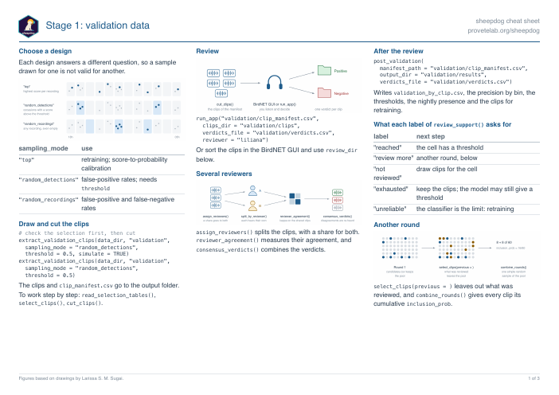
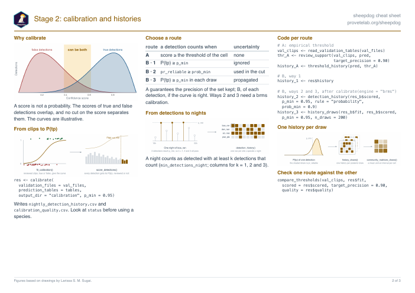
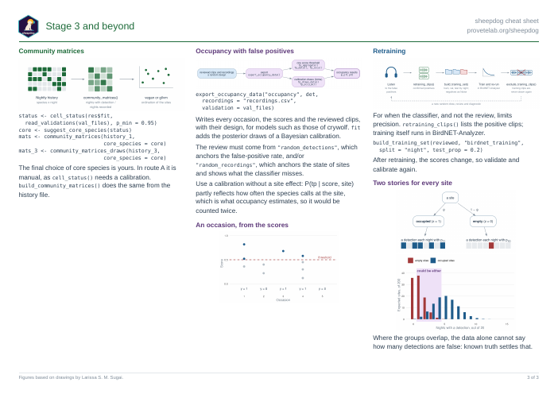
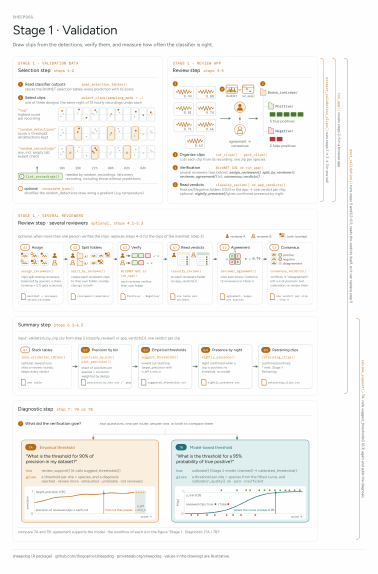
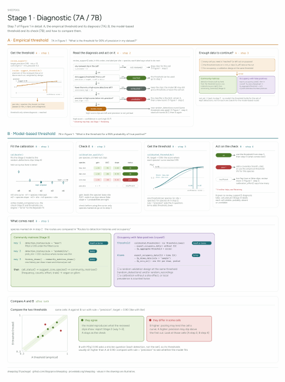
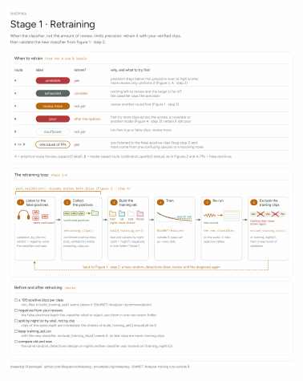
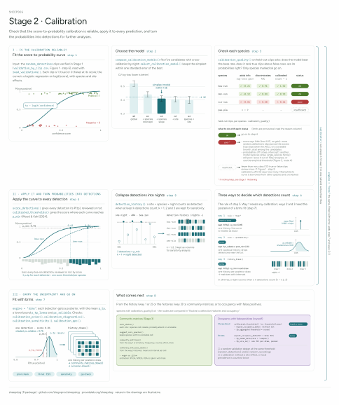
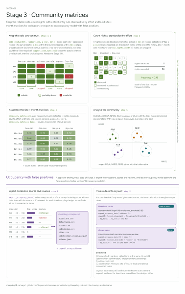

Printable summaries of sheepdog, with the main functions and figures of each
stage. The figures are based on drawings by Larissa S. M. Sugai.

## The three stages

[Download the PDF](../cheatsheets/sheepdog-cheatsheet.pdf) (A4 landscape, three
pages).

[](../cheatsheets/sheepdog-cheatsheet.pdf)

[](../cheatsheets/sheepdog-cheatsheet.pdf)

[](../cheatsheets/sheepdog-cheatsheet.pdf)

## Illustrated guide

Five posters drawn by Larissa S. M. Sugai, which go through the stages in
detail: validation, the diagnostic, retraining, calibration, and the community
matrices with occupancy. They refer to each other as Figures 1 to 5, the order
of the pages.

[Download the PDF](../cheatsheets/sheepdog-illustrated-guide.pdf) (five pages).

The posters predate the review rounds. For another round, use
`select_clips(previous = )` and `combine_rounds()` rather than a new seed
(`vignette("validation-effort")`). "Routes to detection histories and
occupancy" is now the article [Choosing a route](choosing-a-route.html).

```{=html}
<div style="display: grid; grid-template-columns: repeat(auto-fill, minmax(150px, 1fr)); gap: 12px; align-items: start;">
<a href="../cheatsheets/sheepdog-illustrated-guide.pdf"></a>
<a href="../cheatsheets/sheepdog-illustrated-guide.pdf"></a>
<a href="../cheatsheets/sheepdog-illustrated-guide.pdf"></a>
<a href="../cheatsheets/sheepdog-illustrated-guide.pdf"></a>
<a href="../cheatsheets/sheepdog-illustrated-guide.pdf"></a>
</div>
```
