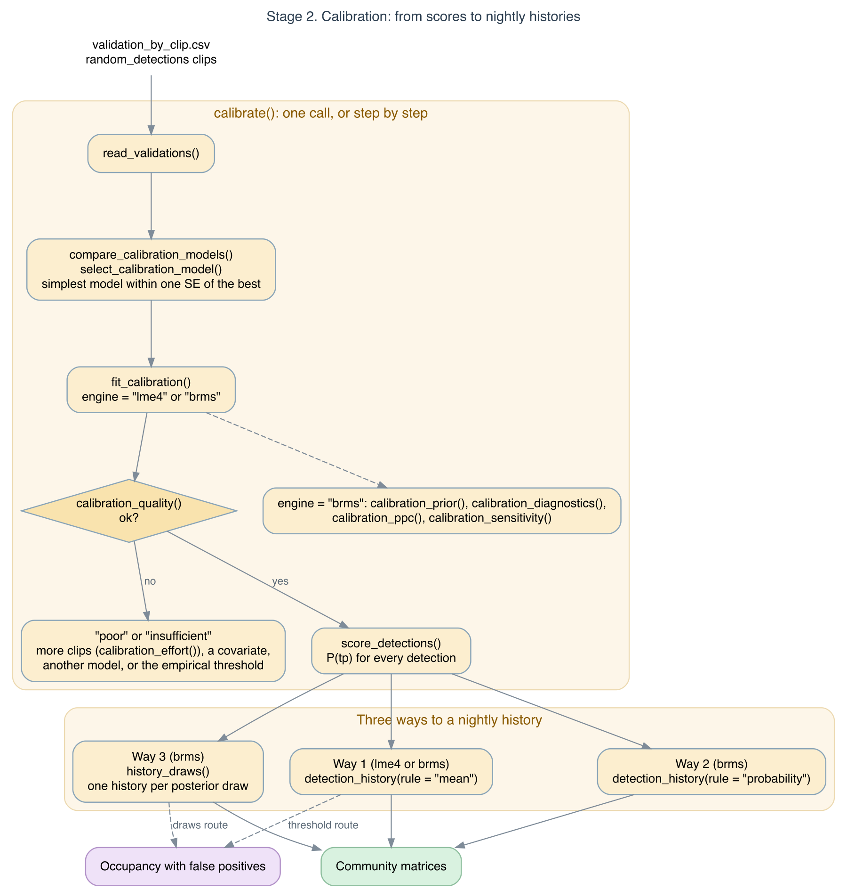
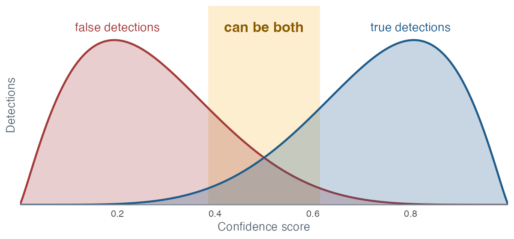
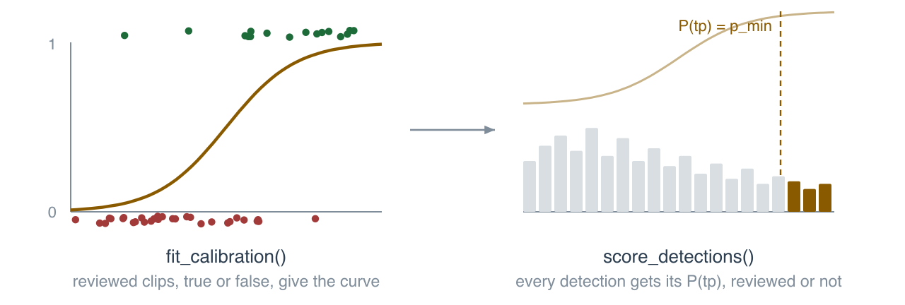
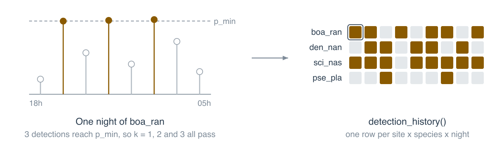

```{r, include = FALSE}
knitr::opts_chunk$set(collapse = TRUE, comment = "#>")
has_lme4    <- requireNamespace("lme4", quietly = TRUE)
has_ggplot2 <- requireNamespace("ggplot2", quietly = TRUE)
has_mgcv    <- requireNamespace("mgcv", quietly = TRUE)
```

This vignette covers the second stage of sheepdog in detail: turning
BirdNET confidence scores into probabilities that a detection is a true
positive, scoring every detection, and building nightly detection
histories. Each step is run on the example data shipped with the package.

{width=100%}

```{r, message = FALSE}
library(sheepdog)
library(dplyr)
ex <- system.file("extdata", "example", package = "sheepdog")
```

## Why calibrate

A BirdNET confidence score is a classifier output in [0, 1], not a
probability that the detection is correct. Wood & Kahl (2024) describe
two ways to use the scores: reviewing the detections down to a chosen
score, or converting the scores into probabilities of a true detection,
for studies in which the detections cannot all be reviewed. The conversion
is a logistic regression of the verdict on a sample of manually validated
detections; on logit(score), it is applied, for instance, by Owens et al.
(2026).

{width=100%}

One curve for all species is rarely enough. The same score can mean
different things for different species, because the score distributions
of true and false detections differ among species, and for the same
species at different sites, because the rate of false detections depends
on background noise and the rate of true ones on how often the species is
present. sheepdog therefore fits hierarchical logistic models in which the
intercept and the slope on logit(score) can vary among species and among
sites.

## The example data

The example data are simulated (`data-raw/make_example_data.R`). Eight
anuran species were recorded at four sites over six months, from October
2021 to March 2022. When a species is present, its true detections have
scores drawn from a species-specific Beta distribution. Every species also
produces false positives in every recording, present or not, with scores
drawn from a second species-specific Beta distribution. For five species
(`boa_ran`, `den_nan`, `lep_fus`, `pse_pla`, `sci_nas`) the two
distributions overlap widely; the other three (`ela_bic`, `lep_pod`,
`phy_cuv`) produce few false positives, with low scores, and are well
separated. The rate of false positives is multiplied by a site noise
factor (ARA 0.7, BAI 1.0, XAR 1.5, NHE 2.2). Presence varies with season
and site, including a random preference of each species for each site.
The same score therefore corresponds to different probabilities of a true
detection among species and sites. The verdicts of the reviewed clips
come from the simulated truth.

The reviewed clips are the `validation_by_clip_<site>.csv` tables written
by `post_validation()`. `read_validations()` stacks them, keeps the clips
with a positive or negative verdict and a confidence score, and adds
`logit_conf` and the binary response `tp`.

```{r}
val_files <- list.files(file.path(ex, "validation"), full.names = TRUE)
val <- read_validations(val_files)
table(val$site, val$species)
```

The clips were selected with the `"top"` design (the two highest scores per
site x species x night x hour, at most `r max(table(val$site, val$species))`
per site x species). Cells where a species was rarely detected hold fewer
clips (as few as `r min(table(val$site, val$species))`). Precision differs
widely among species:

```{r}
val |>
  group_by(species) |>
  summarise(clips = n(), precision = mean(tp),
            min_conf = min(confidence), median_conf = median(confidence))
```

## Candidate models

`calibration_models()` returns the family of candidate models. All of them
are binomial regressions of `tp` on `logit_conf`. They differ in how the
calibration curve is allowed to vary among species and sites.

```{r}
models <- calibration_models()
cat(paste0(names(models), ": ", vapply(models, deparse1, "")), sep = "\n")
```

* `m0_global`: one curve for all species and sites (a GLM).
* `m1_species_intercept`: species shift the curve along the score axis.
* `m2_species_slope`: species also differ in how steeply the probability
  rises with the score.
* `m3_plus_site`: as m2, plus a site intercept shared by all species.
* `m4_species_x_site`: as m2, plus an intercept for each site x species
  combination. This is the most flexible model.

Models m1 to m4 are binomial GLMMs fitted with `lme4::glmer()`.

## Comparing models by cross-validation

`compare_calibration_models()` fits every candidate with k-fold
cross-validation and computes the area under the ROC curve (AUC) on the
held-out folds. By default, clips are assigned within site x species.
The fold assignment uses a fixed `seed`. Five folds run in a few seconds
on these data. Clips from the same recording may then appear on both
sides; use grouped folds when evaluating new recordings or nights.

```{r, eval = has_lme4}
cv <- compare_calibration_models(val, models, k_folds = 5)
cv |> select(model, auc_mean, auc_sd, n_failed)
```

```{r, include = FALSE, eval = has_lme4}
auc_of <- function(m) round(cv$auc_mean[cv$model == m], 3)
```

The table is ordered by mean AUC. Read the differences between models
together with the spread among folds (`auc_sd`), and check `n_failed`
(folds whose fit failed and were left out of the mean; none here). In the
example, each added level of structure raises the mean AUC by more than
the fold-to-fold standard deviation: from
`r if (has_lme4) auc_of("m0_global")` for the global model to
`r if (has_lme4) auc_of("m1_species_intercept")` with species intercepts,
`r if (has_lme4) auc_of("m2_species_slope")` with species slopes,
`r if (has_lme4) auc_of("m3_plus_site")` with site intercepts and
`r if (has_lme4) auc_of("m4_species_x_site")` with site x species
intercepts. When differences are of the same order as `auc_sd`, the order
of the table can change with `k_folds` or `seed`.

AUC measures discrimination (whether true detections score higher than
false ones), not calibration (whether a predicted probability of 0.9 is
correct nine times in ten). Two models with equal AUC can still give
different probabilities, so the comparison is a first filter, not the
whole decision.

### Scoring the probabilities and choosing a model

The comparison also scores the predicted probabilities themselves on the
held-out folds. The log-loss and the Brier score are proper scoring rules:
their expected value is best when the predicted probabilities are the true
ones, so they reward correct probabilities and not only their ranking
(Gneiting & Raftery 2007). The log-loss penalises confident mistakes
heavily, which is where `p_min` operates. The calibration intercept and
slope come from a logistic regression of the verdicts on the logit of the
predicted probabilities in each test fold: a well calibrated model has
intercept 0 and slope 1, and a slope below 1 means probabilities that are
too extreme. `prop_singular` is the share of fold fits that were singular.

```{r, eval = has_lme4}
cv |>
  select(model, logloss_mean, logloss_sd, brier_mean, cal_intercept,
         cal_slope, prop_singular)
```

`select_calibration_model()` applies a selection rule to this table.
`"best_auc"` takes the highest mean AUC, the rule `calibrate()` uses by
default in 2.x. `"one_se_logloss"` leaves out the models that are singular
in most folds and, among the rest, keeps the simplest one whose mean
log-loss is within one standard error of the lowest. This is the default
in 3.0.0. See `vignette("migration-3.0.0")` for the migration guide.

```{r, eval = has_lme4}
select_calibration_model(cv, "best_auc")
select_calibration_model(cv, "one_se_logloss", k_folds = 5)
```

```{r, include = FALSE, eval = has_lme4}
sel_auc <- select_calibration_model(cv, "best_auc")
sel_ll  <- select_calibration_model(cv, "one_se_logloss", k_folds = 5)
```

Here the highest AUC belongs to `r if (has_lme4) sel_auc`, singular in
`r if (has_lme4) round(100 * cv$prop_singular[cv$model == sel_auc])` % of
the folds, and the log-loss rule retains `r if (has_lme4) sel_ll`.
`calibration_models(uncorrelated = TRUE)` adds a sixth candidate, the m4
structure without the correlation between the species intercepts and
slopes, which is the term that makes m4 singular (see the next section):

```{r, eval = has_lme4}
models_u <- calibration_models(uncorrelated = TRUE)
cv_u <- compare_calibration_models(val, models_u, k_folds = 5)
cv_u |> select(model, auc_mean, logloss_mean, logloss_sd, prop_singular)
select_calibration_model(cv_u, "one_se_logloss", k_folds = 5)
```

`calibrate()` takes the rule in `select` and the extra candidate with
`uncorrelated = TRUE`. Whether the retained model is a sound fit is a
separate question, taken up next.

## Fitting the calibration model

`fit_calibration()` fits a model to all the reviewed clips and stores the
species and site levels with it, for `score_detections()` and
`plot_calibration()`. We fit every candidate, because whether a GLMM is
singular is part of the choice:

```{r, eval = has_lme4}
fits <- lapply(models, function(f) fit_calibration(val, f))
vapply(fits[-1], lme4::isSingular, logical(1))
```

```{r, eval = has_lme4}
fit_global <- fits$m0_global
fit_full   <- fits$m4_species_x_site
coef(fit_global)
lme4::fixef(fit_full)
lme4::VarCorr(fit_full)
```

The site x species intercepts of m4 have a standard deviation of
`r if (has_lme4) round(attr(lme4::VarCorr(fit_full)[["site:species"]], "stddev"), 2)`
on the logit scale, a large effect: at a given score, the odds of a true
detection differ several-fold among sites for the same species. The fit is
nevertheless singular, which is why `fit_calibration()` warned above (it
is the only singular fit among the candidates): the
correlation between the species intercepts and
slopes is estimated at
`r if (has_lme4) round(attr(lme4::VarCorr(fit_full)$species, "correlation")[1, 2], 2)`,
on the boundary of its range. With `r nlevels(val$species)` species, a
correlation between two random effects is poorly identified. A singular
fit means that the random-effect structure is more complex than the data
can support. The predictions can still be used, but this variance
component should not be interpreted. The singularity lies in the species
term, not in the site x species term that gives m4 its advantage. m2 and
m3 share the same species term and are not flagged as singular, but in m3
the correlation is already
`r if (has_lme4) round(attr(lme4::VarCorr(fits$m3_plus_site)$species, "correlation")[1, 2], 2)`,
close to the boundary: the species intercepts and slopes are nearly
collinear in every model. Here the choice is between m4, singular in a
component that does not drive its predictions but clearly better in the
cross-validation, and m3, a regular fit with a lower AUC. We keep m4 for
the rest of the vignette and do not interpret its species correlation.
Fitting m4 without the correlation (with
`(1 | species) + (0 + logit_conf | species)`) would be a further option,
but it is not one of the built-in candidates.

## Calibration curves

{width=100%}

`plot_calibration()` draws the calibrated probability against the score,
one panel per species and one line per site. The points give the observed
precision of the reviewed clips in 0.1-wide score bins, sized by the
number of clips. The dashed line marks `p_min`.

```{r, eval = has_lme4 && has_ggplot2, fig.width = 7, fig.height = 5.5, out.width = "100%"}
plot_calibration(fit_full, val, p_min = 0.95, model_name = "m4_species_x_site")
```

Look for:

* **Flat or shallow curves.** A species whose curve rises slowly, or never
  reaches `p_min`, is poorly separated from its false positives. Its
  calibrated detections should not enter the analyses, or only in a
  sensitivity analysis.
* **Sites that diverge.** A site whose curve lies far from the others for
  the same species may differ in noise, in the number of false positives,
  or in the review. Check its clips before trusting its probabilities.
* **Curves that miss the points.** Systematic departures from the observed
  precision indicate lack of fit, usually in the score bins with the
  largest points.
* **Few clips.** Curves supported by small points (few clips per bin) are
  extrapolations. The `"top"` design gives few clips at low scores, so the
  lower part of each curve rests mainly on the shared fixed effects.

In the example, all of these appear. The three well-separated species
(`ela_bic`, `lep_pod`, `phy_cuv`) have steep curves that cross `p_min` at
moderate scores and lie close together among sites. `pse_pla` has a
shallow curve that stays below `p_min` at every site: its false positives
overlap its true detections too much for any score to be reliable.
`sci_nas` and `den_nan` reach `p_min` only near the top of the score range,
except at ARA, the quietest site, where their curves lie to the left.
`lep_fus` diverges most among sites: its curves at ARA and BAI lie far
below those at NHE and XAR. The species is rarely present at ARA and BAI,
so most of its detections there are false, and these two cells also hold
the fewest reviewed clips.

The practical consequence is the score at which each site x species
reaches `p_min`. Under the global model this score is the same everywhere:

```{r, eval = has_lme4}
grid <- tidyr::expand_grid(
  species    = factor(levels(val$species), levels = levels(val$species)),
  site       = factor(levels(val$site), levels = levels(val$site)),
  confidence = seq(0.10, 0.99, by = 0.01)
) |>
  mutate(logit_conf = qlogis(confidence),
         p_global   = predict(fit_global, newdata = pick(everything()),
                              type = "response"),
         p_full     = predict(fit_full, newdata = pick(everything()),
                              type = "response"))

# lowest score with P(TP) >= 0.95; NA if never reached below 0.99
first_conf <- function(conf, p) {
  if (any(p >= 0.95)) min(conf[p >= 0.95]) else NA_real_
}
thresholds <- grid |>
  group_by(species, site) |>
  summarise(conf_global = first_conf(confidence, p_global),
            conf_full   = first_conf(confidence, p_full),
            .groups = "drop")
thresholds |> print(n = Inf)
```

```{r, include = FALSE, eval = has_lme4}
never <- thresholds |> filter(is.na(conf_full))
```

Under m4, the score needed to reach P(TP) >= 0.95 ranges from
`r if (has_lme4) min(thresholds$conf_full, na.rm = TRUE)` to
`r if (has_lme4) max(thresholds$conf_full, na.rm = TRUE)` among site x
species combinations, and `r if (has_lme4) nrow(never)` combinations
(`r if (has_lme4) paste(unique(as.character(never$species)), collapse = ", ")`)
never reach it, against a single threshold of
`r if (has_lme4) unique(thresholds$conf_global)` under the global model.
A single score threshold, or a single calibration curve, would be too
lenient for some species and sites and too strict for others.

## Checking the shape of the curve

The logistic curve assumes that P(TP) is linear in the logit of the score.
When it is not, the curve can fit the bulk of the clips, at low scores,
and still be wrong near the threshold, where it matters; cross-validated
log-loss, dominated by the bulk, may not show it.
`compare_calibration_curves()` fits, for each species, the logistic, a
quadratic, a GAM (package `mgcv`) and a monotone GAM (package `scam`), and
judges them in the high score bins and by their thresholds:
`threshold_precision`, the cut from which the precision of the clips kept,
as predicted by the curve, reaches the target, is compared with
`threshold_weighted`, the same cut from the reviewed clips alone (the
weighted count of `suggest_thresholds()`).

```{r, eval = has_mgcv}
val_tab <- read_validation_tables(val_files)
cmp <- compare_calibration_curves(val_tab, target = 0.95,
                                  curves = c("logistic", "quadratic", "gam"))
cmp |>
  filter(curve == "logistic") |>
  select(species_folder, verdict, threshold_precision, threshold_weighted,
         top_error_excess) |>
  as.data.frame()
```

The verdict follows the decision table of the threshold workflow:
`"keep_logistic"` when the logistic fits the high bins as well as the
flexible curves and its threshold agrees with the weighted count;
`"use_monotone_or_weighted"` when it does not; `"no_curve_reaches_target"`
when no curve and not even the reviewed clips reach the target, a problem
of the classifier that no threshold fixes; and
`"sample_more_near_threshold"` when the high bins hold too few clips to
judge. Here the well-separated species keep the logistic, `pse_pla` and
`lep_fus` reach the target with no curve, and `den_nan` and `sci_nas` reach it with the
weighted count but not with the logistic, whose shape misses the top of
the score range. These example clips come from the `"top"` design, with no
inclusion probabilities; with clips of `"random_detections"` or
`"score_bands"` the fits and precisions are weighted by
`1 / inclusion_prob`.

```{r, eval = has_mgcv && has_ggplot2, fig.width = 7, fig.height = 5.5, out.width = "100%"}
plot_calibration_curves(cmp, validation = val_tab)
```

## Scoring every detection

`score_detections()` reads the complete selection tables (not only the
reviewed clips) and predicts P(TP) for every detection of a calibrated
species. The tables are passed as a vector named by site; the names must
match the sites of the calibration. A site absent from the calibration is
scored with the species effects only, with a warning. The night of a
detection is its recording date, or the day before for recordings that
start before `dawn_hour`.

```{r, eval = has_lme4}
sites  <- c("ARA", "XAR", "BAI", "NHE")
tables <- setNames(file.path(ex, "birdnet", sites,
                             "BirdNET_SelectionTable.txt"), sites)
scored <- score_detections(tables, fit_full, min_confidence = 0.1) |>
  suppressMessages()  # one line per site with the number of detections
scored |> select(site, species, night, confidence, p_tp)
```

## Confidence thresholds from the calibration

Stage 1 suggests a threshold per site and species from the reviewed clips
of that cell alone (`suggest_thresholds()`). The calibration model gives
a second route, following Wood & Kahl (2024): the threshold is the score at
which the calibrated probability of a true positive reaches a target.
Because the model has species and site effects, a cell with few reviewed
clips borrows strength from the others, and the threshold does not depend
on how the reviewed clips were spread over the scores, as long as they
were chosen by their score only.

`calibrated_thresholds()` has two rules. With `rule = "probability"`, the
threshold is the lowest score at which P(TP) reaches the target and stays
above it for every higher score:

```{r, eval = has_lme4}
thr_p <- calibrated_thresholds(fit_full, target = 0.95, scored = scored)
thr_p
```

With `rule = "precision"`, the threshold is the lowest score at which the
expected precision of the detections kept (the mean P(TP) of every
detection of the cell above the threshold) reaches the target. It answers
the same question as `suggest_thresholds()`, but from every detection of
the selection tables instead of the reviewed clips, and it is lower than
the threshold of `"probability"`, because the detections above a score are
more reliable than a detection at that score:

```{r, eval = has_lme4}
thr_q <- calibrated_thresholds(fit_full, target = 0.95, rule = "precision",
                               scored = scored)
thr_q
```

A threshold is `NA` when the cell never reaches the target. With a model
fitted with `engine = "brms"`, `rule = "probability"` also returns
`threshold_lower`, the score at which the lower quantile of the posterior of
P(TP) reaches the target.

Two cautions. With a site effect, P(TP | score, site) mixes the error of
the classifier with how often the species calls at the site; for a
threshold this is what is wanted, but it is not a property of the
classifier alone. And the site-confirmation design of the false-positive
occupancy models in 'crywolf' needs clips drawn at random, not chosen by
score: a sample designed for the thresholds does not serve it.

`calibrate()` writes the `"probability"` thresholds with `target = p_min`
to `thresholds.csv`. They are the score equivalent of the cut on P(TP)
used for the detection histories below, and serve to filter detections in
software that only accepts a score threshold.

### Comparing the thresholds

`compare_thresholds()` puts the empirical threshold of `suggest_thresholds()`
and the model thresholds side by side for each site x species, and
`post_validation(fit = )` writes the table to `thresholds_compared.csv`.
Compare `thr_empirical` with `thr_model_precision`, which answer the same
question; `flag` does this, and `thr_p_tp` stays out of it, since it is higher
for the same target. A `"disagree"` points to the model (its form, a missing
covariate) or to the sample (few clips, missing weights). Trust the model
columns only for a calibration compared by cross-validation and with
`calibration_quality()` status `"ok"` for the species, which the `quality`
argument carries into the table, and read with care a model threshold above
the highest reviewed score of the cell (`above_reviewed`). Clips used here to
set the threshold should not be reused as confirmation data in the occupancy
model without saying so.

### Choosing a confidence threshold

The routes to a threshold answer different questions and need different
samples of reviewed clips:

| question | tool | threshold | reviewed clips needed |
|---|---|---|---|
| one cut for every site and species, as in the BirdNET output | `fit_calibration()` with `m0_global`, then `calibrated_thresholds()` | one score | any sample that spans the scores |
| what share of the detections above a score are true, in this cell? | `suggest_thresholds()` | per site x species | drawn at random within the cell, and numerous |
| at which score is a detection reliable, borrowing strength across cells? | `calibrated_thresholds(rule = "probability")` | per site x species | chosen by score only (e.g. `"top"`), if the model form is right |
| what share of all the detections kept are true, borrowing strength? | `calibrated_thresholds(rule = "precision")` | per site x species, lower | as above, plus the selection tables |
| can the score threshold be dropped? | `score_detections(p_min = )` and `detection_history()` | on P(TP), not on the score | as above |

A single threshold is the simplest choice, but the comparison above shows
that the score at which P(TP) reaches 0.95 varies widely among sites and
species, so a single cut keeps many false positives in some cells and
discards many true detections in others.

Thresholds that differ among sites have a consequence for the occupancy
model. The detection probability depends on the threshold, so per-site
thresholds make it differ among sites for a reason unrelated to the
species; the detection submodel should then include the site, or the
threshold itself, as a covariate. Whatever the threshold, the false
positives that remain above it are what the false-positive occupancy
models of 'crywolf' estimate, and the `"random_detections"` sample that
confirms them must be drawn with the same threshold as the analysis (see
`vignette("sampling-designs")`). Thresholding P(TP) instead of the score
keeps the meaning of a detection the same in every cell.

## Nightly detection histories

{width=100%}

`detection_history()` aggregates the scored detections by site x species
x night. A detection is reliable when its calibrated probability is at
least `p_min`; the threshold applies to P(TP), not to the score. A night
has a detection when it holds at least k reliable detections
(`min_detections_night`, the repetition rule). The columns
`detection_k1` to `detection_k3` give the same rule with k = 1, 2 and 3;
`detection` uses the chosen k.

```{r, eval = has_lme4}
history <- detection_history(scored, p_min = 0.95, min_detections_night = 1)
history
summarise_history(history) |> print(n = Inf)
```

`nights` counts the nights with any scored detection, and `nights_k1` to
`nights_k3` the nights with a detection under each rule. The gap between
`nights` and `nights_k1` is the number of nights whose detections were
all below `p_min`: nights that a rule on the raw output (any detection
above `min_confidence`) would have counted as detections. Species whose
curves never reach `p_min` have no night with a detection, whatever their
scores.

This is one of four routes to a detection history; the [choosing a route](https://provetelab.org/sheepdog/articles/choosing-a-route.html)
article compares them with the empirical threshold of stage 1.

## Choosing p_min and k

`p_min` and k trade false-positive nights against missed nights. A high
`p_min` with k = 1 accepts a night on one very reliable detection; a lower
`p_min` with k = 2 or 3 requires repeated, moderately reliable detections.
The choice should follow the analysis: occupancy models with
false-positive parameters can tolerate a lenient rule, whereas analyses
with no false-positive component (for example, ordinations of community
matrices) call for a strict one. The sensitivity of the number of nights
with a detection to both settings is cheap to check:

```{r, eval = has_lme4}
sensitivity <- lapply(c(0.80, 0.90, 0.95, 0.99), function(p) {
  detection_history(scored, p_min = p) |>
    summarise(p_min = p, k1 = sum(detection_k1), k2 = sum(detection_k2),
              k3 = sum(detection_k3))
}) |>
  bind_rows()
sensitivity
```

```{r, include = FALSE, eval = has_lme4}
k1_range <- range(sensitivity$k1)
```

The number of nights with a detection under k = 1 falls from
`r if (has_lme4) k1_range[2]` to `r if (has_lme4) k1_range[1]` across this
range of `p_min`. If the conclusions of the downstream analysis change
across the range, report the results under more than one setting.

The same check applies to the choice of model. Scoring with the global
model and comparing the histories shows how many site x species x nights
change, and for which species:

```{r, eval = has_lme4}
history_global <- score_detections(tables, fit_global) |>
  suppressMessages() |>
  detection_history(p_min = 0.95)
compare <- inner_join(history, history_global,
                      by = c("site", "species", "night"),
                      suffix = c("_full", "_global"))
compare_sp <- compare |>
  group_by(species) |>
  summarise(nights = n(),
            k1_full = sum(detection_k1_full),
            k1_global = sum(detection_k1_global),
            differ_k1 = sum(detection_k1_full != detection_k1_global))
compare_sp
```

The global model changes the history of
`r if (has_lme4) sum(compare$detection_k1_full != compare$detection_k1_global)`
of `r if (has_lme4) nrow(compare)` site x species x nights under k = 1. It
accepts fewer nights than m4 for
`r if (has_lme4) paste(with(compare_sp, as.character(species[k1_global < k1_full])), collapse = ", ")`,
which reach P(TP) >= 0.95 below the common threshold at some or all
sites, and more nights for
`r if (has_lme4) paste(with(compare_sp, as.character(species[k1_global > k1_full])), collapse = ", ")`,
whose calibrated probabilities m4 places lower.

## When the global model is enough

The global model is enough when the hierarchical models do not improve
the cross-validated AUC beyond the fold-to-fold variation, when the
species and site curves of a hierarchical model lie close together near
`p_min`, and when the detection histories do not change between models.
None of these holds in the example. With very few species or sites the
variance components are poorly estimated, and a simpler model (a species
effect only, or the global model) is the more defensible choice; with
many species, or species and sites known to differ in noise, the
hierarchical models keep the threshold on P(TP) consistent across them.

## Model checks

Before using calibrated probabilities, check that:

1. **The GLMM converged.** `fit_calibration()` warns when the refitted
   model is singular, as it did for m4 above, and convergence warnings of
   `lme4::glmer()` are passed on. `compare_calibration_models()` drops a
   fold whose fit fails from the mean AUC, warns about it and counts it in
   `n_failed`. Inspect the refitted model directly:

   ```{r, eval = has_lme4}
   lme4::isSingular(fit_full)
   fit_full@optinfo$conv$lme4$messages
   ```

   Here the only message is the singular fit discussed above; there are no
   convergence warnings. Convergence warnings (as opposed to a singular
   fit) mean the estimates should not be used: simplify the random-effect
   structure, or review more clips.
2. **The cross-validation supports the choice.** Read `auc_sd` with
   `auc_mean`. Do not prefer a more complex model on a difference smaller
   than the fold-to-fold variation.
3. **The calibration curves are sensible.** Curves should increase with
   the score, follow the observed precision, and rest on enough clips near
   `p_min`. `calibration_effort()` estimates how many clips per site x
   species are needed for a stable AUC.
4. **The probabilities hold for each species.** See the next section.

The calibration also assumes that, within a score level, the reviewed
clips are representative of all the detections of that species at that
site. The model is conditional on the score, so the `"top"` design, which
oversamples high scores, does not bias it as long as this holds. It fails
if the clips were chosen by another criterion related to correctness (for
example, only clips that sounded clear, or only the nights of peak
activity), or if the reviewed period differs from the scored one in noise
or in species composition.

## Checking the quality of P(TP) by species

The measures above describe a model over all the clips. A logistic
regression can still fit poorly for one species, and the mean AUC does not
show it: the AUC rises when species differ in precision, and partial
pooling lends a species with an uninformative score the curve of the
others. `calibration_quality()` refits one model by cross-validation and
scores the held-out predictions within each group. It compares the model
with a null model, the share of true positives of the group in the training
folds (`logloss_gain`), reports the AUC of the probabilities (`auc`) and of
the raw score (`auc_score`) within the group, and the calibration intercept
and slope. `calibrate()` writes this table to `calibration_quality.csv`.

```{r, eval = has_lme4}
quality <- calibration_quality(val, models$m4_species_x_site)
quality |>
  select(species, n_fp, auc, auc_score, logloss_gain, cal_slope, status) |>
  mutate(across(where(is.numeric), \(x) round(x, 2)))
```

```{r, include = FALSE, eval = has_lme4}
q_of <- function(col) round(quality[[col]][quality$species == "pse_pla"], 2)
```

The mean AUC of this model is `r if (has_lme4) auc_of("m4_species_x_site")`,
but the score of `pse_pla` has an AUC of `r if (has_lme4) q_of("auc_score")`
within the species: its probabilities reach an `auc` of
`r if (has_lme4) q_of("auc")` through the site x species intercepts, not
through the score. They mostly give the precision of each cell, and a
threshold on the score would separate little. `status` marks such a group
as `"poor"`, and `reason` says why. `by = c("site", "species")` gives the
same table for each cell, which holds fewer clips, so more groups come out
as `"insufficient"` (fewer than `min_class` clips of a verdict).

The limits behind `status` (`auc_min`, `slope_range`, `intercept_max`) are
screening values, to be set for each project. Discrimination is also
measured over the scores that were reviewed: the `"top"` design concentrates
the clips at high scores, and can give a low AUC even with a good classifier,
so check `conf_min` and `conf_max` before blaming the classifier. A group
marked `"poor"` needs more clips, ideally from `"random_detections"`, a
different model, or a decision to leave it out of the analyses that use
P(TP).

## One species, or one site

When `models` is omitted, `compare_calibration_models()` chooses the family
from the observed levels. For one species at several sites it compares a
global model, a site intercept and a site intercept/slope model. The same
choice is automatic in `calibrate()`. One species at one site needs only
the global model; multiple species at one site use the species-effect
candidates without non-estimable site random effects. Unused factor levels
do not count as observed species or sites.

To construct the single-species family explicitly, use
`calibration_models(single_species = TRUE)`. An explicit list overrides
automatic choice in the comparison. The original multispecies family and
its ordering remain available through `calibration_models()`.

The [performance vignette](performance.html) documents the Curiango
regression checks and the multispecies simulation; it distinguishes
predictive performance from changes in detection histories.

## Keeping recordings and nights intact

`fold_group = "source_audio"` keeps recordings together, and
`fold_group = "night"` keeps nights together. The group key always
includes site and spans all species: detections of the same recording or
night cannot leak across training and test sets through different
species. Group counts are balanced within site; clip counts may differ.
Each site needs at least `k_folds` distinct groups. This evaluates new
recordings or nights at known sites, not transfer to new sites. Rare
species may be absent from a particular train or test partition.

Retain the metadata explicitly when assembling the stages by hand:

```{r, eval = FALSE}
val_grouped <- read_validations(val_files, keep = c("source_audio", "night"))
folds <- calibration_folds(val_grouped, k_folds = 5, seed = 2026,
                           fold_group = "night")
cv_grouped <- compare_calibration_models(
  val_grouped, models, k_folds = 5, seed = 2026, fold_group = "night")
selected <- select_calibration_model(cv_grouped, k_folds = 5)
```

For custom tables, a vector of column names can define a compound group,
e.g. `fold_group = c("recorder", "night")`. IDs must be nonempty and
nonmissing. Supply real recording/night metadata; grouping by clip file,
species or verdict would not preserve the acoustic unit.

`calibrate(fold_group = "night", ...)` retains the requested input
columns automatically and saves the assignments in `calibration_folds.csv`
for inspection. Older validation tables without those columns still work
with the default clip folds. Asking for absent metadata raises an error.
A test fold containing only one verdict has undefined AUC; log-loss and
Brier remain available, and it is not counted as a failed fit. AUC-based
selection requires at least one finite AUC.

## The calibrate() wrapper

`calibrate()` runs the whole stage in one call. It reads the clips,
compares the candidate models, refits the one chosen by the rule in
`select`, plots the calibration curves (if ggplot2 is installed), scores
every detection, builds the detection history and writes all the outputs
to `output_dir`. The default `select = "one_se_logloss"` applies the
log-loss and one-standard-error rule described above. Set
`select = "best_auc"` to retain the 2.x selection by highest mean AUC;
that rule can retain a singular model and warns on a singular final fit.
Use `uncorrelated = TRUE` to include the uncorrelated m4 variant in the
candidates. Read the comparison, `calibration_model.txt` and the curves
before using the output.

```{r, eval = has_lme4}
out_dir <- file.path(tempdir(), "calibration")
res <- calibrate(validation_files  = val_files,
                 prediction_tables = tables,
                 output_dir        = out_dir,
                 select = "one_se_logloss", uncorrelated = TRUE,
                 p_min = 0.95, min_detections_night = 1, k_folds = 5) |>
  suppressMessages()
deparse1(res$fit@call$formula)  # the model calibrate() refitted
list.files(out_dir)
```

`nightly_detection_history.csv` is the input of the occupancy and
community analyses (see `vignette("frognet-workflow")`). Five folds and
the example's `r nrow(val)` clips run in seconds; a project with thousands
of clips and many species takes longer, and `effort_curve = TRUE` adds the
effort curve.

## References

Gneiting, T., & Raftery, A. E. (2007). Strictly proper scoring rules,
prediction, and estimation. *Journal of the American Statistical
Association*, 102, 359–378. https://doi.org/10.1198/016214506000001437

Owens, G., Wood, C. M., Hunt, T. J., Bussolini, L. T., Kreisl, A.,
Alves, F., & Stojanovic, D. (2026). Passive acoustic monitoring of the rare
orange-bellied parrot: automated detection using BirdNET-based transfer
learning. *bioRxiv*. https://doi.org/10.64898/2026.06.01.729442

Wood, C. M., & Kahl, S. (2024). Guidelines for appropriate use of BirdNET
scores and other detector outputs. *Journal of Ornithology*, 165, 777–782.
https://doi.org/10.1007/s10336-024-02144-5
