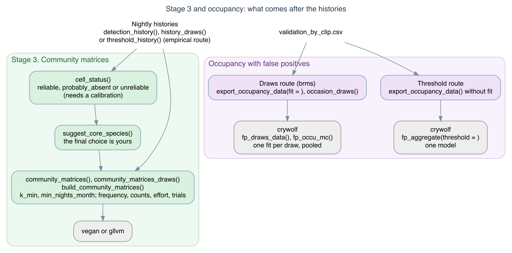

```{r, include = FALSE}
knitr::opts_chunk$set(collapse = TRUE, comment = "#>")
has_vegan   <- requireNamespace("vegan", quietly = TRUE)
has_ape     <- requireNamespace("ape", quietly = TRUE)
has_ggplot2 <- requireNamespace("ggplot2", quietly = TRUE)
has_gllvm   <- requireNamespace("gllvm", quietly = TRUE)
has_lme4    <- requireNamespace("lme4", quietly = TRUE)
run_pcoa    <- has_vegan && has_ape
```

Stage 3 of sheepdog turns the calibrated nightly detection history into
site x month community matrices for multivariate analyses. This vignette
runs that stage on the example data shipped with the package, and then uses
the matrices in a distance-based ordination (PCoA) and in a model-based
ordination and test with generalised linear latent variable models (GLLVM).

{width=100%}

{width=100%}

```{r}
library(sheepdog)
```

## The calibrated detection history

The example history is the output of `calibrate()` on simulated BirdNET
predictions for four sites and six months (October 2021 to March 2022),
with five recorded nights per site x month, except for one recorder
failure. In the simulation, occupancy depends on species-specific
seasonality (most species prefer the rainy months, November to February;
one prefers the dry months) and on species x site preferences; the
false-positive scores overlap those of true detections, at rates that vary
among species and sites (`data-raw/make_example_data.R`).

```{r}
ex <- system.file("extdata", "example", package = "sheepdog")
history_file <- file.path(ex, "nightly_detection_history.csv")
history <- readr::read_csv(history_file, show_col_types = FALSE,
                           col_types = readr::cols(night = "c"))
history
```

```{r, include = FALSE}
sites   <- sort(unique(history$site))
species <- sort(unique(history$species))
```

The history covers `r length(sites)` sites (`r sites`) and
`r length(species)` species (`r species`). Each row is a site x species x
night. `n_reliable` counts the detections whose calibrated probability of
being a true positive reached `p_min` in `calibrate()`; `detection_k1` to
`detection_k3` flag nights with at least one, two or three such detections.

Other routes lead to a history too (a stricter rule, or one history per
posterior draw); the [choosing a route](https://provetelab.org/sheepdog/articles/choosing-a-route.html) article compares them.

## Why the entry rule must be strict

Occupancy models with false positives include an observation layer that
absorbs misidentifications, provided that part of the detections are
confirmed (see `vignette("crywolf-integration")`). Dissimilarity indices and
ordinations have no such layer: a single false positive becomes a species
"present" in a sample and contributes directly to beta diversity.
`community_matrices()` therefore applies three filters.

* **Repetition rule (`k_min`).** A species counts as detected on a night
  only when it had at least `k_min` reliable detections that night (column
  `detection_k<k_min>`). An isolated high-probability detection is more
  likely to be an error than repeated ones.
* **Core species.** Only species whose calibration is reliable at every
  site enter the matrix. If the classifier has lower recall, or a poorer
  calibration, at some sites, the resulting differences in detection would
  appear as artefactual turnover among sites.
* **Minimum effort (`min_nights_month`).** Each cell is the frequency of
  nights with detection, standardised by effort (nights with detection /
  nights recorded at that site x month). Cells with fewer recorded nights
  than `min_nights_month` give unstable frequencies and are dropped.

## Choosing the core species

A species with no reliable detection at a site may be absent there, or the
calibration may fail there: the classifier may detect it, but never with a
calibrated probability that reaches `p_min`. Only the first case allows a
zero in the matrix. `cell_status()` separates the two from the calibration
model and the reviewed clips. Each site × species cell is

* `"reliable"`: the calibrated curve reaches `p_min` within the reviewed
  scores, with at least `min_n` reviewed clips;
* `"probably_absent"`: clips were reviewed, but none was a true positive;
* `"unreliable"`: true positives were reviewed, but the curve never
  reaches `p_min` (or too few clips were reviewed).

Here the calibration model is refitted to the reviewed clips shipped with
the example (the model `calibrate()` refits; see
`vignette("calibration")`):

```{r, eval = has_lme4}
val_files <- list.files(file.path(ex, "validation"), full.names = TRUE)
val <- suppressMessages(read_validations(val_files))
# m4 is singular on these data; the warning is discussed in the calibration
# article
fit <- suppressWarnings(fit_calibration(val,
                                        calibration_models()$m4_species_x_site))
status <- cell_status(fit, val, p_min = 0.95, min_n = 15)
status |>
  dplyr::select(species, site, status) |>
  tidyr::pivot_wider(names_from = site, values_from = status)
```

`suggest_core_species()` keeps the species with no unreliable cell:

```{r, eval = has_lme4}
core <- suggest_core_species(status)
core
```

```{r, include = FALSE, eval = has_lme4}
absent_cells <- status |> dplyr::filter(status == "probably_absent")
unrel_sp <- sort(unique(status$species[status$status == "unreliable"]))
```

```{r, include = FALSE, eval = !has_lme4}
core <- c("boa_ran", "ela_bic", "lep_pod", "phy_cuv")
absent_cells <- data.frame(species = character(), site = character())
unrel_sp <- character()
```

Species with at least one unreliable cell (`r unrel_sp`) stay out. Cells
classified as probably absent (`r paste(absent_cells$species,
absent_cells$site)`) do not exclude a species: a zero there is a plausible
absence, not a failure of the classifier. The choice remains the
analyst's; the table is the evidence for it.

`summarise_history()` gives a complementary view: the number of nights
with a reliable detection per site and species (shown here for
`k_min = 1`):

```{r}
summarise_history(history) |>
  dplyr::select(site, species, nights_k1) |>
  tidyr::pivot_wider(names_from = site, values_from = nights_k1)
```

## Building the matrices

```{r}
mats <- community_matrices(history, core_species = core, k_min = 2,
                           min_nights_month = 5)
names(mats)
```

The effort table lists the recorded nights per site x month and whether the
cell entered the matrices.

```{r}
mats$effort
mats$effort |> dplyr::filter(!included)
```

```{r, include = FALSE}
n_cells    <- nrow(mats$effort)
n_included <- sum(mats$effort$included)
dropped    <- mats$effort |> dplyr::filter(!included)
dropped_txt <- paste0(dropped$site, " in ", dropped$month, " (",
                      dropped$n_nights_recorded, " nights)",
                      collapse = "; ")
```

Of the `r n_cells` site x month cells, `r n_included` entered the matrices.
The cell dropped by `min_nights_month = 5` is `r dropped_txt`, the month of
the simulated recorder failure; it remains listed in the effort table with
`included = FALSE`. Effort is approximated by the number of distinct nights
that appear in the history of the site for any species, which is adequate
when detections are dense, as here.

The count matrix holds the number of nights with detection, and the
frequency matrix divides it by the recorded nights:

```{r}
mats$counts
mats$frequency
```

## Sensitivity to the repetition rule

The repetition rule trades false positives against missed detections. The
mean frequency of each core species across cells shows how the matrix
changes with `k_min`:

```{r}
sens <- lapply(1:3, function(k) {
  community_matrices(history, core, k_min = k)$frequency |>
    dplyr::summarise(dplyr::across(dplyr::all_of(core), mean)) |>
    dplyr::mutate(k_min = k, .before = 1)
}) |>
  dplyr::bind_rows()
sens
```

```{r, include = FALSE}
loss <- round(100 * (1 - unlist(sens[3, core]) / unlist(sens[1, core])))
most  <- names(which.max(loss))
least <- names(which.min(loss))
```

From `k_min = 1` to `3`, the mean frequency of `r least` falls by
`r loss[least]`%, whereas that of `r most` falls by `r loss[most]`%. The
rule therefore acts unevenly among species, and its effect on later
analyses should be reported. `k_min = 2` is the default.

## Writing the matrices to disk

`build_community_matrices()` is the wrapper that reads
`nightly_detection_history.csv`, calls `community_matrices()` and writes
the frequency and count matrices and the effort table as CSV files:

```{r}
out <- file.path(tempdir(), "community_matrices")
mats <- build_community_matrices(history_file, out, core_species = core,
                                 k_min = 2, min_nights_month = 5)
list.files(out)
```

## Preparing the samples

Both analyses below use the same samples. Samples in which no core species
was detected are removed first (`drop_empty = TRUE`): their Bray–Curtis
dissimilarity is undefined, and they carry no information on species
co-occurrence. Season is coded as rainy (November to February) or dry.

```{r}
mats_ord <- community_matrices(history, core_species = core, k_min = 2,
                               min_nights_month = 5, drop_empty = TRUE)
samples <- mats_ord$counts |>
  dplyr::mutate(
    season = factor(ifelse(substr(month, 6, 7) %in% c("11", "12", "01", "02"),
                           "rainy", "dry"), levels = c("dry", "rainy")),
    site = factor(site)
  )
freq <- as.matrix(samples[, core]) / samples$n_nights_recorded
rownames(freq) <- paste(samples$site, samples$month)
```

```{r, include = FALSE}
n_empty <- nrow(mats$counts) - nrow(samples)
n_kept  <- nrow(samples)
```

`r n_empty` sample(s) removed; `r n_kept` samples x `r length(core)`
species remain. The example has only `r length(sites)` sites and six
months, so the analyses below illustrate the workflow; they do not support
general conclusions.

## Distance-based ordination: PCoA on Bray–Curtis

The choice of resemblance coefficient determines what an ordination
represents; Legendre & Legendre (2012) review the properties of the
coefficients. Here we use Bray–Curtis on the frequency matrix, which
retains the quantitative information of the frequencies (Jaccard on
incidence would discard it). Bray–Curtis is not Euclidean, so a principal
coordinates analysis (PCoA) of it produces negative eigenvalues, which have
no geometric representation. Its square root is Euclidean (Legendre &
Legendre 2012), and we use it below. The PCoA is computed with
`ape::pcoa()`.

```{r, eval = run_pcoa}
bc      <- vegan::vegdist(freq, method = "bray")
pcoa_bc <- ape::pcoa(bc)
pcoa_sq <- ape::pcoa(sqrt(bc))
tol <- 1e-8
c(bray_curtis      = sum(pcoa_bc$values$Eigenvalues < -tol),
  sqrt_bray_curtis = sum(pcoa_sq$values$Eigenvalues < -tol))
```

```{r, include = FALSE, eval = run_pcoa}
n_neg <- sum(pcoa_bc$values$Eigenvalues < -tol)
rel   <- round(100 * pcoa_sq$values$Relative_eig[1:2], 1)
```

`r if (run_pcoa) paste0("Untransformed Bray–Curtis yields ", n_neg, " negative eigenvalues; its square root yields none.") else ""`
An alternative is to keep the untransformed coefficient and correct the
negative eigenvalues, with the Lingoes or Cailliez corrections offered by
`ape::pcoa()` (`correction = "lingoes"` or `correction = "cailliez"`);
both are described by Legendre & Legendre (2012).

```{r, eval = run_pcoa}
head(pcoa_sq$values[, c("Eigenvalues", "Relative_eig")], 3)
scores_pcoa <- data.frame(samples[, c("site", "month", "season")],
                          PCo1 = pcoa_sq$vectors[, 1],
                          PCo2 = pcoa_sq$vectors[, 2])
```

```{r, eval = run_pcoa && has_ggplot2, fig.width = 6, fig.height = 4.5, fig.alt = "PCoA of the site x month samples on square-root Bray-Curtis, coloured by site, with shape by season."}
# amostras com frequencias identicas cairiam no mesmo ponto: um pequeno
# deslocamento aleatorio deixa todas visiveis
jit <- 0.02 * diff(range(scores_pcoa$PCo1))
ggplot2::ggplot(scores_pcoa,
                ggplot2::aes(PCo1, PCo2, colour = site, shape = season)) +
  ggplot2::geom_point(size = 3, alpha = 0.7,
                      position = ggplot2::position_jitter(jit, jit, seed = 1)) +
  ggplot2::labs(
    x = sprintf("PCo1 (%.1f%%)", rel[1]),
    y = sprintf("PCo2 (%.1f%%)", rel[2]),
    colour = "Site", shape = "Season"
  ) +
  ggplot2::theme_bw()
```

Samples with identical frequencies would share a single point; the points
are jittered slightly so that all of them are visible.

## Model-based ordination: GLLVM

The response in each cell is a count out of a known number of trials:
nights with detection out of nights recorded. A distance-based ordination
discards that structure; frequencies from cells with different effort are
treated alike, and the mean–variance relationship of the counts is
ignored, which can confound differences in location with differences in
dispersion (Warton, Wright & Wang 2012). A binomial GLLVM models the counts
directly: effort enters through the number of trials (`Ntrials`), the
binomial variance handles the mean–variance relationship, and the latent
variables give a model-based ordination of the samples (Warton et al. 2015;
Niku et al. 2019). Jupke & Schäfer (2020) compare model- and distance-based
multivariate methods.

```{r, eval = has_gllvm}
Y  <- as.matrix(samples[, core])
storage.mode(Y) <- "double"
rownames(Y) <- rownames(freq)
Nt <- mats_ord$trials
```

`Ntrials` must be a matrix with the dimensions of the response when effort
varies among samples; `community_matrices()` returns it as `trials`. With `r length(core)` species, the default
starting values of `gllvm()` fail for two latent variables, so the model
starts from zero (`starting.val = "zero"`).

```{r, eval = has_gllvm}
fit_lv <- gllvm::gllvm(y = Y, family = "binomial", Ntrials = Nt,
                       num.lv = 2, starting.val = "zero", seed = 2026)
fit_lv
```

```{r, eval = has_gllvm && has_ggplot2, fig.width = 6, fig.height = 4.5, fig.alt = "Latent variables of the binomial GLLVM for the site x month samples, coloured by site, with shape by season; species loadings shown as labels."}
lv <- data.frame(samples[, c("site", "season")], gllvm::getLV(fit_lv))
ld <- data.frame(species = core, gllvm::getLoadings(fit_lv))
k  <- max(abs(lv[, c("LV1", "LV2")])) / max(abs(ld[, c("LV1", "LV2")]))
jit <- 0.02 * diff(range(lv$LV1))
ggplot2::ggplot(lv, ggplot2::aes(LV1, LV2)) +
  ggplot2::geom_point(ggplot2::aes(colour = site, shape = season),
                      size = 3, alpha = 0.7,
                      position = ggplot2::position_jitter(jit, jit, seed = 1)) +
  ggplot2::geom_text(data = ld,
                     ggplot2::aes(LV1 * k, LV2 * k, label = species),
                     colour = "grey30", size = 3.5) +
  ggplot2::scale_x_continuous(expand = ggplot2::expansion(mult = 0.15)) +
  ggplot2::scale_y_continuous(expand = ggplot2::expansion(mult = 0.1)) +
  ggplot2::labs(colour = "Site", shape = "Season",
                caption = "Species loadings (labels) rescaled to the LV range; points jittered slightly") +
  ggplot2::theme_bw()
```

The residual correlations among species, induced by the latent variables,
summarise which species tend to be detected in the same samples:

```{r, eval = has_gllvm}
round(gllvm::getResidualCor(fit_lv), 2)
```

With `r if (has_gllvm) n_kept else "about twenty"` samples,
`r length(core)` species and two latent variables, the loadings and
residual correlations are weakly identified, and solutions can change with
the starting values; they are shown here as an illustration.

## Model-based inference: species responses to season

A GLLVM can also test hypotheses, by adding covariates with
species-specific coefficients. The question here is whether species
respond to season. The model includes:

* species-specific season effects (`formula = ~ season`);
* effort, through `Ntrials`;
* a random intercept for site, shared by all species
  (`row.eff = ~(1 | site)`, with `studyDesign` naming the site of each
  sample), which accounts for months of the same site not being
  independent;
* one latent variable, for residual co-occurrence (for instance, from
  species x site preferences not captured by the site intercept).

The test is a likelihood-ratio test between this model and the same model
without season (`anova()` on the two fits).

```{r, eval = has_gllvm}
X      <- data.frame(season = samples$season)
design <- data.frame(site = samples$site)
fit_season <- gllvm::gllvm(y = Y, X = X, formula = ~ season,
                           family = "binomial", Ntrials = Nt, num.lv = 1,
                           row.eff = ~ (1 | site), studyDesign = design,
                           starting.val = "zero", seed = 2026)
fit_null   <- gllvm::gllvm(y = Y, family = "binomial", Ntrials = Nt,
                           num.lv = 1, row.eff = ~ (1 | site),
                           studyDesign = design,
                           starting.val = "zero", seed = 2026)
lrt <- anova(fit_null, fit_season)
```

```{r, include = FALSE, eval = has_gllvm}
lrt_d  <- round(lrt$D[2], 1)
lrt_df <- lrt$Df.diff[2]
lrt_p  <- if (lrt$P.value[2] < 1e-4) "< 0.0001" else
  paste("=", signif(lrt$P.value[2], 2))
sigma_site <- signif(fit_season$params$sigma, 2)
```

`r if (has_gllvm) paste0("The likelihood-ratio statistic is D = ", lrt_d, " on ", lrt_df, " degrees of freedom (one season coefficient per species; P ", lrt_p, "). The estimated standard deviation of the site intercept is ", sigma_site, ", so in this example the shared site effect is negligible once the species-specific terms are in the model.") else ""`

The species-specific season coefficients (rainy relative to dry, on the
logit scale) and their 95% Wald intervals:

```{r, eval = has_gllvm}
ci <- confint(fit_season, parm = "Xcoef")
season_coef <- data.frame(species = core,
                          estimate = fit_season$params$Xcoef[, "seasonrainy"],
                          lower = ci[, 1], upper = ci[, 2],
                          row.names = NULL)
season_coef |>
  dplyr::mutate(dplyr::across(estimate:upper, \(x) signif(x, 3))) |>
  tibble::as_tibble()
```

```{r, include = FALSE, eval = has_gllvm}
sep_sp  <- core[which.max(abs(season_coef$estimate))]
sep_rainy <- all(samples[[sep_sp]][samples$season == "rainy"] > 0)
neg_sp  <- season_coef$species[season_coef$estimate < 0]
```

`r if (has_gllvm) paste0("The negative coefficient of ", paste(neg_sp, collapse = ", "), " matches its preference for the dry season in the simulation. The estimate of ", sep_sp, " is large and its interval is degenerate: the species was detected in ", if (sep_rainy) "every" else "almost every", " rainy-season sample, so the data are close to complete separation and the coefficient is not identified.") else ""`
Such intervals should not be read as estimates of precision.

### Caveats

* The test uses `r if (has_gllvm) n_kept else "about twenty"` samples from
  `r length(sites)` sites. The site random intercept is estimated from
  `r length(sites)` levels, and the likelihood-ratio test relies on
  large-sample approximations; P-values are approximate.
* Months within a site are also temporally autocorrelated; the site
  intercept accounts for their shared site, not for that autocorrelation.
* In our trials on these data, the model with two latent variables and
  covariates did not converge reliably, and fits with random starting
  values reached lower likelihoods; hence one latent variable and zero starting values.
  With few species the latent part is weakly identified, and results
  should be checked against several starting values (`starting.val`,
  `n.init`).
* The test concerns detection frequency, not occupancy: season may change
  calling activity as well as occurrence.

## References

Legendre, P., & Legendre, L. (2012). *Numerical ecology* (3rd English ed.).
Developments in Environmental Modelling 24. Elsevier.
<https://doi.org/10.1016/C2010-0-66470-4>

Jupke, J. F., & Schäfer, R. B. (2020). Should ecologists prefer model- over
distance-based multivariate methods? *Ecology and Evolution*, 10,
2417–2435. <https://doi.org/10.1002/ece3.6059>

Niku, J., Hui, F. K. C., Taskinen, S., & Warton, D. I. (2019). gllvm: Fast
analysis of multivariate abundance data with generalized linear latent
variable models in R. *Methods in Ecology and Evolution*, 10, 2173–2182.
<https://doi.org/10.1111/2041-210X.13303>

Warton, D. I., Foster, S. D., De'ath, G., Stoklosa, J., & Dunstan, P. K.
(2015). Model-based thinking for community ecology. *Plant Ecology*, 216,
669–682. <https://doi.org/10.1007/s11258-014-0366-3>

Warton, D. I., Wright, S. T., & Wang, Y. (2012). Distance-based
multivariate analyses confound location and dispersion effects. *Methods in
Ecology and Evolution*, 3, 89–101.
<https://doi.org/10.1111/j.2041-210X.2011.00127.x>
